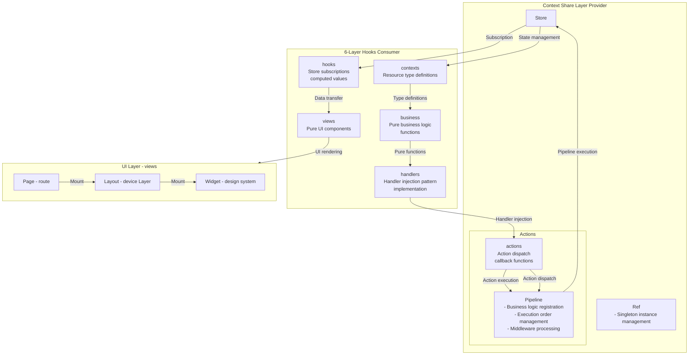
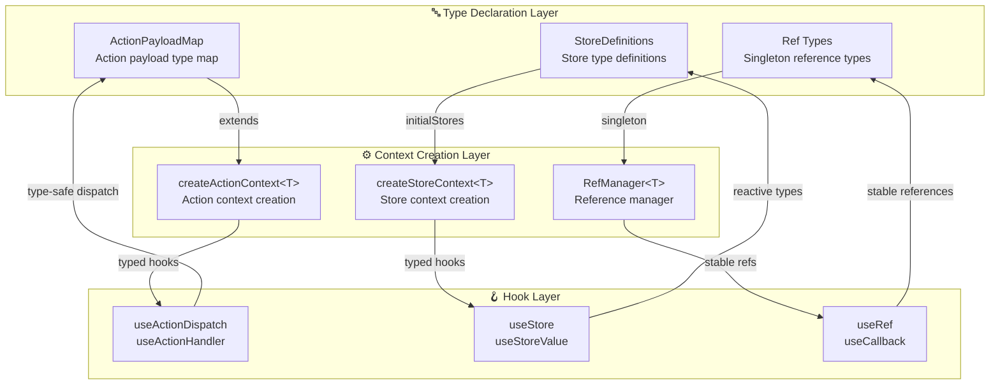

# Context-Action Framework

[](https://www.npmjs.com/package/@context-action/react)
[](https://www.typescriptlang.org/)
[](LICENSE)
[](https://github.com/mineclover/context-action/actions)

**Revolutionary TypeScript state management with document-centric context separation and MVVM architecture.**

**🎯 Perfect separation of concerns** • **🔒 Full type safety** • **⚡ Zero boilerplate** • **🏗️ Scalable architecture**

[📚 Documentation](https://mineclover.github.io/context-action/) • [🎮 Live Demo](https://mineclover.github.io/context-action/example/) • [⚡ Web Coding Studio](https://mineclover.github.io/context-action/web-coding/) • [🚀 Quick Start](#-quick-start)

---

## ⚡ Quick Start

### Installation
```bash
npm install @context-action/react
# or
npm install @context-action/core  # Pure TypeScript
```

### 30-Second Example
```typescript
import { createStoreContext, useStoreValue } from '@context-action/react';
import { useCallback } from 'react';

// 1. Create context
const { Provider, useStore } = createStoreContext('User', {
  profile: { name: 'John', email: 'john@example.com' }
});

// 2. Use in component  
function UserProfile() {
  const profileStore = useStore('profile');
  const profile = useStoreValue(profileStore);
  
  return <h1>Welcome, {profile.name}!</h1>;
}

// 3. Wrap with provider
function App() {
  return (
    <Provider>
      <UserProfile />
    </Provider>
  );
}
```

**That's it!** 🎉 Full type safety, reactive updates, and clean architecture.

---

## 🎯 Why Context-Action?

### ❌ Problems with Existing Libraries
- **High React Coupling** → Difficult component modularization
- **Binary State Approach** → Poor scope-based separation  
- **Complex Boilerplate** → Verbose setup and maintenance

### ✅ Context-Action's Solution
- **🎯 Document-Centric Design** → Context separation based on domain boundaries
- **🏗️ MVVM Architecture** → Perfect separation: Model, ViewModel, View layers
- **🔒 Type-First Approach** → Zero runtime errors with full TypeScript support
- **⚡ Zero Boilerplate** → Minimal code, maximum functionality

### 🚀 Key Benefits
```typescript
// Before: Complex setup with multiple libraries
const store = createStore(reducer);
const dispatch = useDispatch();
const selector = useSelector(state => state.user);
const actions = bindActionCreators(userActions, dispatch);

// After: One line with Context-Action
const { profile, updateProfile } = useUserPage(); // All logic in hook
```

---

## 🏗️ Core Patterns

### 🏪 Store Pattern
**Pure state management with reactive subscriptions**

```typescript
const { Provider: UserStoreProvider, useStore: useUserStore } = createStoreContext('User', {
  profile: { name: '', email: '' },
  settings: { theme: 'light' }
});

function UserComponent() {
  const profileStore = useUserStore('profile');
  const profile = useStoreValue(profileStore);

  return <div>{profile.name}</div>;
}
```

### 🎯 Action Pattern  
**Pure action dispatching with business logic separation**

```typescript
interface UserActions extends ActionPayloadMap {
  updateProfile: { name: string; email: string };
  logout: void;
}

const { Provider, useActionDispatch, useActionHandler } =
  createActionContext<UserActions>('UserActions');

function UserLogic() {
  const updateProfileHandler = useCallback(async (payload) => {
    // Business logic here
    await updateUserAPI(payload);
  }, []);

  useActionHandler('updateProfile', updateProfileHandler);
  
  return null; // Logic component
}
```

### 🔗 Pattern Composition
**Combine patterns for complex applications**

```typescript
// MVVM Architecture
function App() {
  return (
    <UserActionProvider>     {/* ViewModel */}
      <UserStoreProvider>    {/* Model */}
        <UserLogic>          {/* Business Logic */}
          <UserProfile />    {/* View */}
        </UserLogic>
      </UserStoreProvider>
    </UserActionProvider>
  );
}
```

### 🏗️ 6-Layer Hooks Architecture

**Context-Action implements a 6-layer hooks architecture (`contexts / business / handlers / actions / hooks / views`) that provides clear separation of concerns and optimal performance through delayed evaluation.**



#### 🔄 Data Flow Principles

1. **Context Share Layer (Provider)**
   - **Store**: Centralized state management with reactive subscriptions
   - **Actions/Pipeline**: Business logic registration and execution order management
   - **Ref**: Singleton instance management for performance optimization

2. **6-Layer Hooks Structure (Consumer)**
   - **contexts**: Resource type definitions and context access
   - **business**: Pure business logic functions separated from side effects
   - **handlers**: Handler injection pattern implementation with latest value access
   - **actions**: Action dispatch functions and callback management
   - **hooks**: Store subscriptions and computed values for reactive data
   - **views**: Pure UI components with minimal coupling

3. **UI Layer (Views)**
   - **Page**: Route-level components
   - **Layout**: Device-specific layout components
   - **Widget**: Design system components

#### ⚡ Performance Benefits

- **Delayed Evaluation**: Handlers access latest state via `store.getValue()`
- **Selective Subscriptions**: Components subscribe only to needed state slices
- **Minimal Re-renders**: Optimized dependency tracking prevents unnecessary updates
- **Singleton Management**: Ref layer ensures efficient resource sharing

```typescript
// 6-Layer Implementation Example (contexts / business / handlers / actions / hooks / views)
// 1. business: pure domain transform
const applyProfilePatch = (current: UserProfile, patch: Partial<UserProfile>) => ({
  ...current,
  ...patch,
});

// 2. handlers: register orchestration logic with delayed store.getValue() evaluation
function UserHandlers({ children }: { children: React.ReactNode }) {
  const userStore = useUserStore('profile');

  const updateUserHandler = useCallback(async (payload: Partial<UserProfile>) => {
    const currentUser = userStore.getValue();
    userStore.setValue(applyProfilePatch(currentUser, payload));
  }, [userStore]);

  useActionHandler('updateUser', updateUserHandler);
  return <>{children}</>;
}

// 3. hooks + views: subscribe cleanly and dispatch intent helpers
function UserPage() {
  const user = useStoreValue(useUserStore('profile'));
  const dispatch = useUserActionDispatch();

  return (
    <div>
      <h1>{user.name}</h1>
      <button onClick={() => dispatch('updateUser', { name: 'New Name' })}>
        Update User
      </button>
    </div>
  );
}
```

---

## 🔗 Type System Guidelines

**Context-Action implements a sophisticated type system that provides full TypeScript safety across Action, Store, and Ref connections with zero runtime overhead.**

### 🎯 Type Declaration Architecture



### ⚡ Type Connection Patterns

#### 1. **Action Type Declaration & Connection**
```typescript
// 1️⃣ Define Action Payload Types
interface UserActions extends ActionPayloadMap {
  updateProfile: { name: string; email: string; avatar?: File };
  deleteAccount: { confirmPassword: string };
  logout: void; // No payload
}

// 2️⃣ Create Typed Action Context
const {
  Provider: UserActionProvider,
  useActionDispatch: useUserAction,
  useActionHandler: useUserActionHandler
} = createActionContext<UserActions>('UserActions');

// 3️⃣ Type-Safe Handler Registration
function UserLogic() {
  // ✅ Payload automatically typed as { name: string; email: string; avatar?: File }
  useUserActionHandler('updateProfile', useCallback(async (payload) => {
    // payload.name ✅ string
    // payload.email ✅ string
    // payload.avatar ✅ File | undefined
    await updateUserAPI(payload);
  }, []));

  // ✅ Payload automatically typed as void
  useUserActionHandler('logout', useCallback(async () => {
    await clearSession();
  }, []));
}

// 4️⃣ Type-Safe Action Dispatching
function UserComponent() {
  const dispatch = useUserAction();

  return (
    <button onClick={() =>
      dispatch('updateProfile', {
        name: 'John',
        email: 'john@example.com'
        // ✅ TypeScript enforces correct payload shape
      })
    }>
      Update Profile
    </button>
  );
}
```

#### 2. **Store Type Declaration & Connection**
```typescript
// 1️⃣ Define Store Types (Two Approaches)

// Approach A: Simple Object Types
const { Provider, useStore } = createStoreContext('User', {
  profile: { name: '', email: '', isOnline: false }, // ✅ Type inferred
  settings: { theme: 'light' as const, notifications: true }, // ✅ const assertions
  preferences: { language: 'en', timezone: 'UTC' }
});

// Approach B: Explicit Store Configuration
interface UserStoreConfig {
  profile: StoreConfig<UserProfile>;
  settings: StoreConfig<UserSettings>;
  cache: StoreConfig<CacheData>; // ✅ With strategy configuration
}

const { Provider, useStore } = createStoreContext('User', {
  profile: { initialValue: { name: '', email: '' } },
  settings: { initialValue: { theme: 'light' }, strategy: 'shallow' },
  cache: { initialValue: new Map(), strategy: 'reference' }
} satisfies UserStoreConfig);

// 2️⃣ Type-Safe Store Access & Subscription
function UserProfile() {
  const profileStore = useStore('profile'); // ✅ Store<UserProfile>
  const profile = useStoreValue(profileStore); // ✅ UserProfile type

  // ✅ Type-safe store operations
  profileStore.setValue({ name: 'John', email: 'john@example.com', isOnline: true });
  profileStore.update(prev => ({ ...prev, isOnline: !prev.isOnline }));

  return <div>{profile.name}</div>; // ✅ profile.name is string
}
```

#### 3. **Ref Type Declaration & Singleton Management**
```typescript
import { createRefContext, createStoreContext } from '@context-action/react';

// 1️⃣ Ref Type Declarations for Mutable Elements / Imperative Handles
interface AppRefs {
  editorInput: HTMLInputElement;
  apiClient: ApiClient;
}

// 2️⃣ Separate StoreContext (state) and RefContext (refs)
const { Provider: AppStoreProvider, useStore } = createStoreContext('App', {
  user: { name: '', email: '' },
});

const { Provider: AppRefProvider, useRefHandler: useAppRef } =
  createRefContext<AppRefs>('AppRefs');

// 3️⃣ Type-Safe Ref Access
function ApiComponent() {
  const apiClientRef = useAppRef('apiClient'); // ✅ RefState<ApiClient>
  const userStore = useStore('user');

  const fetchUser = useCallback(async (id: string) => {
    const client = apiClientRef.target;
    if (!client) return;
    const userData = await client.get(`/users/${id}`);
    userStore.setValue(userData);
  }, [apiClientRef, userStore]);

  return <button onClick={() => fetchUser('123')}>Fetch User</button>;
}
```

### 🛡️ Type Safety Benefits

#### **Compile-Time Validation**
- ✅ **Action Payload Validation**: Incorrect payload shapes caught at compile time
- ✅ **Store Type Consistency**: Store value types enforced across components
- ✅ **Ref Type Stability**: Singleton reference types maintained across re-renders
- ✅ **Hook Return Types**: All hooks return properly typed values and functions

#### **IntelliSense & Developer Experience**
- 🔍 **Auto-completion**: Full IntelliSense for action names, payload properties, store keys
- 🏷️ **Type Hints**: Hover information shows exact payload and store types
- ⚠️ **Error Prevention**: TypeScript prevents runtime errors before they happen
- 🔄 **Refactoring Safety**: Type-safe refactoring across the entire codebase

#### **Zero Runtime Overhead**
- ⚡ **Compile-Time Only**: All type information removed in production builds
- 📦 **No Type Libraries**: No runtime type checking dependencies
- 🎯 **Direct Performance**: Types guide optimization without runtime cost

### 📚 **Detailed Type System Documentation**

For comprehensive type system coverage, see our dedicated guides:

#### **English Documentation**
- **[📖 TypeScript Type Inference Guide](https://mineclover.github.io/context-action/en/guide/type-inference)** - Complete type inference overview
- **[🎯 Action Type System](https://mineclover.github.io/context-action/en/guide/patterns/action/type-system)** - ActionPayloadMap, pipeline controllers, and handler types
- **[🏪 Store Selection and Usage Guide](https://mineclover.github.io/context-action/en/context-layered/store-selection-and-usage-guide)** - Typed store selection matrix across all workspace packages

#### **Korean Documentation**
- **[🎯 Action Type System (KO)](https://mineclover.github.io/context-action/ko/guide/patterns/action/type-system)** - ActionPayloadMap, type safety, TypeScript integration
- **[🏪 Store Selection and Usage Guide (KO)](https://mineclover.github.io/context-action/ko/context-layered/store-selection-and-usage-guide)** - 패키지별 Store 선택 기준 및 사용법

#### **Core Type System Features**
- **Action Type Safety**: Complete `ActionPayloadMap` interface with pipeline controller types
- **Store Type Inference**: Automatic type inference from initial values with strategy support
- **Handler Configuration**: Type-safe handler registration with comprehensive options
- **Integration Patterns**: Store integration, async handling, and error management
- **Advanced Features**: Conditional types, branded types, and generic utilities

---

## 📋 API Reference

### Core Functions

#### `createStoreContext(name, stores)`
Create typed store context with reactive subscriptions.
```typescript
const { Provider, useStore } = createStoreContext('App', {
  user: { name: '', email: '' },
  settings: { theme: 'light' }
});
```

#### `createActionContext<T>(name)`  
Create typed action context with pipeline processing.
```typescript
interface Actions extends ActionPayloadMap {
  update: { id: string };
}
const { Provider, useActionDispatch } = createActionContext<Actions>('App');
```

### Essential Hooks

#### `useStoreValue(store)`
Subscribe to store changes with automatic re-renders.
```typescript
const userStore = useStore('user');
const user = useStoreValue(userStore); // Reactive subscription
```

#### `useActionHandler(action, handler)`
Register business logic handlers for actions.
```typescript
const updateProfileHandler = useCallback(async (payload) => {
  // Business logic here
}, []);

useActionHandler('updateProfile', updateProfileHandler);
```

#### `useActionDispatch()`
Dispatch actions to the pipeline.
```typescript
const dispatch = useActionDispatch();
dispatch('updateProfile', { name: 'John', email: 'john@example.com' });
```

---

## 🎮 Examples & Demos

### 🚀 Live Interactive Examples
**[Explore 72 canonical example routes →](https://mineclover.github.io/context-action/example/)** ([Catalog Inventory](./catalog/repository-surface/example-surface.v1.json))

#### 🏪 **Store System**
- [Store Basics](https://mineclover.github.io/context-action/example/foundations/store/basics) - Fundamental store creation, updates, and subscriptions
- [Time Travel Store](https://mineclover.github.io/context-action/example/foundations/store/time-travel) - Undo/redo history navigation and timeline inspection
- [React Provider & Hooks](https://mineclover.github.io/context-action/example/foundations/react/provider) - Declarative Action/Store provider separation

#### 🎯 **Action System** 
- [Core Action Basics](https://mineclover.github.io/context-action/example/foundations/core/basics) - Framework-neutral ActionRegister pipeline fundamentals
- [ActionGuard Search](https://mineclover.github.io/context-action/example/performance/action-guard/search) - Debounced and abortable search pipelines
- [Priority System](https://mineclover.github.io/context-action/example/performance/priority/demo) - Priority execution scheduling and tracing

#### 🔗 **Context-Layered & Playbook Examples**
- [Canonical Order Form](https://mineclover.github.io/context-action/example/patterns/implementation-playbook) - Canonical 6-layer reference workflow
- [Layered Architecture](https://mineclover.github.io/context-action/example/patterns/layered-architecture) - Separated contexts, handlers, hooks, and views

### 📖 Real-World Examples
```typescript
// E-commerce Cart System
const CartStores = createStoreContext('Cart', {
  items: [] as CartItem[],
  total: 0,
  shipping: { method: 'standard', cost: 0 }
});

// User Management System  
interface UserActions extends ActionPayloadMap {
  login: { email: string; password: string };
  updateProfile: Partial<UserProfile>;
  logout: void;
}
```

### 🔍 **Observability & Developer Tools**
- **[📊 Action Lifecycle Workbench](https://mineclover.github.io/context-action/example/integrations/action-lifecycle)** - Dispatch traces, handler phases, and abort inspection
- **[📋 Logger System Demo](https://mineclover.github.io/context-action/example/utilities/dev-tools/logger)** - Interactive LogMonitor showcase
- **[⚠️ Warning & Store Scenarios](https://mineclover.github.io/context-action/example/utilities/dev-tools/warning-demo)** - Dependency warning prevention and store strategy inspection

---

## 📚 Documentation

### 📖 Complete Guides
- **[📚 Official Documentation](https://mineclover.github.io/context-action/)** - Complete guide & API portal
- **[🚀 Getting Started Guide](https://mineclover.github.io/context-action/en/guide/getting-started)** - 5-minute setup
- **[🏗️ Context-Layered Architecture](https://mineclover.github.io/context-action/en/context-layered/context-layered-guide)** - Practical 6-layer implementation guide
- **[🧭 Convention Index](https://mineclover.github.io/context-action/en/context-layered/convention-index)** - Central task-based index for standards & gates
- **[📦 Repository Surface Catalog](https://mineclover.github.io/context-action/en/context-layered/repository-surface-catalog)** - All 20 packages, 72 canonical routes, and managed docs (`CA-SURFACE-CATALOG-001`)
- **[🏪 Store Selection and Usage Guide](https://mineclover.github.io/context-action/en/context-layered/store-selection-and-usage-guide)** - Decision matrix across all store/state packages
- **[📋 Architecture Overview](https://mineclover.github.io/context-action/en/concept/architecture-guide)** - Framework concepts
- **[⚡ Best Practices](https://mineclover.github.io/context-action/en/guide/best-practices)** - Production patterns
- **[📜 Documentation & Change Management Conventions](https://mineclover.github.io/context-action/en/concept/documentation-development-conventions)** - Authoritative doc workflow & gates

### 🌏 Multi-Language Support
- **[🇺🇸 English Documentation](https://mineclover.github.io/context-action/en/)** - Complete English guides
- **[🇰🇷 Korean Documentation](https://mineclover.github.io/context-action/ko/)** - Complete Korean guide

---

## 📦 Packages

The monorepo contains **20 workspace packages across 6 layers** (16 publishable, 4 internal workspace tools). See the [Repository Surface Catalog](./docs/en/context-layered/repository-surface-catalog.md) and [`api-surface.v1.json`](./catalog/repository-surface/api-surface.v1.json) for the complete inventory, exports, and verification gates.

- **[@context-action/core](./packages/core)** — Zero-dependency framework-agnostic action pipeline (`ActionRegister`, guards, priority, cancellation, `./element` host bindings).
- **[@context-action/store-core](./packages/store-core)** — Framework-neutral `StateBackend`, `TimelineBackend`, `TransactionBackend`, and `createStateStore` contracts.
- **[@context-action/mutative-core](./packages/mutative-core)** & **[@context-action/mutative](./packages/mutative)** — Upstream-compatible immutable engine (`mutative@1.3.0` lineage) and Context-Action `StateBackend` / time-travel adapter.
- **[@context-action/react](./packages/react)** — React 18/19 MVVM Context bindings (`createActionContext`, `createStoreContext`, `createTimeTravelStoreContext`, `createRefContext`, `./backend`, `./advanced`, `./utils`, `./webmcp`).
- **[@context-action/xstate](./packages/xstate)** — Optional XState v5/v6 (`.`) and Effect (`./effect`) adapters bridging state machines with Action & Store ports.
- **[@context-action/lit](./packages/lit)** & **[@context-action/lit-ui](./packages/lit-ui)** — Lit ReactiveControllers, W3C `@lit/context`, FACE controls, SSR/hydration, and React bridge.
- **[@context-action/preact](./packages/preact)** & **[@context-action/preact-ui](./packages/preact-ui)** — Preact Context + Signals adapters, mount/hydrate roots, custom element bridge, and React bridge.
- **[@context-action/tool-protocol](./packages/tool-protocol)**, **[@context-action/tool-durable-operations](./packages/tool-durable-operations)**, **[@context-action/ai-sdk](./packages/ai-sdk)** & **[@context-action/webmcp](./packages/webmcp)** — Zod action schemas, MCP/provider tool contracts, lease/fenced durable mutation recovery, AI SDK adapter, and browser WebMCP scope.

---

## 🛠️ Development

### Quick Development Setup
```bash
git clone https://github.com/mineclover/context-action.git
cd context-action
pnpm install
pnpm dev  # Start example app
```

### Project Resources
- **[📋 Local-First Verification Policy](./docs/LOCAL_FIRST_VERIFICATION_POLICY.md)** - Local-first verification & receipt contract (`pnpm verify:quick` / `pnpm verify`)
- **[🤝 Contributing Guide](./CONTRIBUTING.md)** - How to contribute
- **[🌐 Ecosystem](./ECOSYSTEM.md)** - Tools and generators  
- **[🛠️ Development Guide](./DEVELOPMENT.md)** - Detailed development setup

---

## 📄 License

Apache-2.0 © [mineclover](https://github.com/mineclover)

---

<div align="center">

**Built with ❤️ for modern TypeScript applications**

[⭐ Star on GitHub](https://github.com/mineclover/context-action) • [🐛 Report Bug](https://github.com/mineclover/context-action/issues) • [💡 Request Feature](https://github.com/mineclover/context-action/discussions)

</div>
