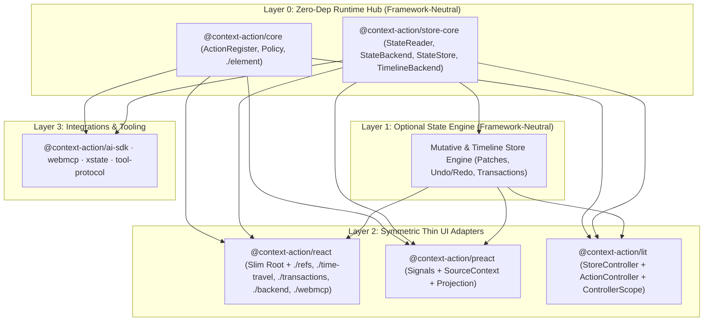

# CA-VNEXT-ARCHITECTURE-001: vNext Hub-and-Spoke API, State Unification, and React Surface Blueprint

**Status:** accepted — Phase 1 (`M0–M4`, 4.x additive alignment) implemented on `stage`; Phase 2 (`v5` major breaking cleanup) deferred pending coordinated release window  
**Owner:** Framework Core & React Runtime  
**Related issue/spec:** `CA-VNEXT-ARCHITECTURE-001` (builds on [CA-SURFACE-CATALOG-001](./CA-SURFACE-CATALOG-001.md), [CA-ELEMENT-INTEROP-001](./CA-ELEMENT-INTEROP-001.md), [CA-STATECHART-EFFECT-001](./CA-STATECHART-EFFECT-001.md), [CA-SPEC-EVIDENCE-001](./CA-SPEC-EVIDENCE-001.md))  
**Baseline:** `stage` (`@context-action/core@1.3.1`, `@context-action/store-core@0.1.4`, `@context-action/mutative-core@0.8.14`, `@context-action/mutative@0.8.15`, `@context-action/react@4.0.7`, `@context-action/lit@0.1.4`, `@context-action/preact@0.1.3`; package versions frozen during pre-release stage work)

---

## 1. Context & Rollout Staging Note

While sibling projects and external integrations rely on the currently published `@context-action/*` 4.x / 1.x / 0.x contracts, breaking root `.` removals, default notification/queue flips, or version bumps must wait for a coordinated release window.

Therefore, this record splits adoption cleanly into two phases:

1. **Phase 1 (`M0–M4` — 4.x Non-Breaking / Additive Alignment, Implemented on `stage`):** Delivers native `StateReader`/`StateBackend`/`TimelineBackend` interop in React hooks and Providers (`M1a`/`M1b`), Core contract-level `actions` queue/timeout policies (`M2`), Layer 1 `@context-action/mutative` `StateStore` and mutable `notificationMode` parity (`M3`), opt-in subpaths (`./refs`, `./time-travel`, `./transactions`), and symmetric dispatch hooks (`useActionResultDispatch()`, `useActionScope()`) (`M4`) while preserving 100% of root `.` exports and existing defaults.
2. **Phase 2 (`v5` Major Breaking Cleanup, Deferred):** Stages removal of deprecated APIs (`useActionEffectHandler`, `compareStrategy`, `StoreSchema`), root barrel slimming, and default timing/queue harmonization once cross-project migration windows open.

---

## 2. Verified Primary-Source Evidence Inventory

Every architectural tension analyzed in this proposal is grounded directly in the stabilized `stage` codebase (`d21aff4a`):

| Axis | Observation & Structural Tension | Primary Source Evidence (Verified) |
|---|---|---|
| **Package Footprint & Surface Asymmetry** | `@context-action/core` is a 0-dep action control plane (`ActionRegister.ts`: 3,394 lines) with isolated subpaths (`.`, `./element`, `./element/react`). Slim adapters stay tiny (`@context-action/lit`: 31 lines exporting 3 controllers; `@context-action/preact`: 6 lines exporting 4 primitives), while `@context-action/react` carries 5 subpaths (`.`, `./backend`, `./advanced`, `./utils`, `./webmcp`), a 102-line root barrel, and the concrete `Store` (`1,057` lines) + `BackendStore` (`376` lines). | `catalog/repository-surface/api-surface.v1.json`, `packages/core/package.json`, `packages/core/src/ActionRegister.ts`, `packages/react/package.json`, `packages/react/src/index.ts:1-102`, `packages/react/src/stores/core/Store.ts:1-1057`, `packages/react/src/stores/core/BackendStore.ts:1-376`, `packages/lit/src/index.ts:1-31`, `packages/preact/src/index.ts:1-6` |
| **Axis 1: State Primitive & Reader Fragmentation** | `@context-action/store-core` (`92` lines implementation, `102` lines contracts) already defines framework-neutral `StateReader<T>`, `StateWriter<T>`, `StateBackend<T>`, `StateStore<T>`, `TimelineBackend<T>`, and `TransactionBackend<T>`. Yet `@context-action/react` constrains `useStoreValue` to `IStore<any>` and `ExternalStoresMap<T>` (`createStoreContext().Provider stores={...}`) to concrete `Store<T[K]>` coupled to `@context-action/mutative`. Injecting a `store-core` `StateStore<T>` requires the 376-line `BackendStore` adapter via `@context-action/react/backend` and still cannot plug directly into `ExternalStoresMap`. Meanwhile, Lit defines `ReadableStore<T>` and Preact defines `ReadableSource<T>` + `SnapshotStateReader<T>` + `fromStateReader()`. | `packages/store-core/src/contracts.ts:36-95`, `packages/store-core/src/index.ts:28-92`, `packages/react/src/stores/core/contracts.ts:12-38`, `packages/react/docs/state-contracts.md:62-97`, `packages/react/src/stores/hooks/useStoreValue.ts:60-92`, `packages/react/src/stores/patterns/declarative-store-pattern-v2.tsx:145-147`, `packages/react/src/stores/core/Store.ts:1,105,874`, `packages/react/src/backend.ts:1-30`, `packages/lit/src/types.ts:29-51`, `packages/preact/src/source-signal.ts:19-40` |
| **Axis 1b: Synchronous vs. RAF-Batched Defaults** | `createStateStore()` in `store-core` commits and notifies listeners synchronously. Concrete `Store<T>` in `@context-action/react` defaults `notificationMode` to `'batched'` (16ms `requestAnimationFrame` scheduling via `frame-scheduler.ts`), requiring explicit fake-timer RAF ticks or `waitFor()` delays even in headless/unit scenarios unless overridden. | `packages/react/src/stores/core/Store.ts:105,874`, `packages/store-core/src/index.ts:50-61`, `example/src/pages/performance/action-guard/scroll/ScrollHandlerRegistry.test.tsx:88-140` |
| **Axis 2: Core vs. React Queue Asymmetry & Deadlock Risk** | `ActionRegister` enables `useConcurrencyQueue` only when `config.registry?.useConcurrencyQueue === true` (and documents re-entry rules in `packages/core/docs/action-contracts.md`). `createActionContext` in `@context-action/react` flips the default to `useConcurrencyQueue: config?.registry?.useConcurrencyQueue ?? true`. During stabilization (`stage` commit `c07882b1`), two production/demo flows deadlocked until `{ immediate: true }` (with explicit `undefined` placeholders for `void` payloads per `DispatchArgs<P>`) was added at call sites: `resetDraft`/`retrySubmission` in `template-react` and `recordExecutionStep`/`recordHandlerExecution` in `FlowControlActions`. | `packages/core/src/ActionRegister.ts:322`, `packages/core/src/types.ts` (`DispatchArgs`), `packages/core/docs/action-contracts.md:43-60`, `packages/react/src/actions/ActionContext.tsx:314`, `packages/template-react/src/features/order-workspace/actions/useOrderActions.ts:17-30`, `example/src/pages/patterns/pipeline/actions/FlowControlActions.tsx:30-39` |
| **Axis 2b: Dispatch Hook Asymmetry & Level 1↔2 Boilerplate** | `useActionDispatch()` returns a single dispatch function while `useActionDispatchWithResult()` returns a 4-field object (`{ dispatch, dispatchWithResult, abortAll, resetAbortScope }`). Escalating from Level 1 Lite to Level 2 Headless-First Symmetric DI duplicates definitions (`new ActionRegister()` + `createStore()` alongside `createActionContext()` + `createStoreContext()`) and requires nested `ownership="shared"` Providers. | `packages/react/src/actions/ActionContext.types.ts:123,177-182`, `packages/react/__tests__/patterns/right-sized-adoption.integration.test.tsx:186-248,310-323` |
| **Axis 3: React Root Barrel Sprawl & Carry-Over Deprecations** | `packages/react/src/index.ts` exports Action, Store, TimeTravel, Transactions (`StoreTransactionCoordinator`, `ActionTransactionBridge`), `StoreErrorBoundary`, `RefContext`, `ActionRegister`, React helpers, and deprecated legacy contracts (`useActionEffectHandler`, `StoreConfig.compareStrategy`, `StoreSchema`, legacy `TransactionBackend` in React state contracts) from the single root `.` surface. | `packages/react/src/index.ts:1-102`, `packages/react/src/actions/ActionContext.types.ts:137-150`, `packages/react/src/stores/patterns/declarative-store-pattern-v2.tsx:53,136`, `packages/react/src/stores/core/contracts.ts:26-38` |

### 2.1 Cross-Project Consumer Audit Evidence (7 Live Repositories)

Read-only auditing across sibling workspaces actively consuming `@context-action/*` validated every structural axis above:

| Consumer Repository | Dependency Baseline | Observed Integration Pattern & Real Friction Evidence |
|---|---|---|
| **`browser-studio`** | `@context-action/core@^1.3.1`, `@context-action/store-core@^0.1.4`, `@context-action/xstate@^0.1.0` *(no React adapter)* | • Hand-rolls `history[]` + `historyCursor` + `structuredClone` undo/redo on top of `createStateStore()` because `TimeTravelStore` resides inside `@context-action/react` (`browser-studio/packages/blueprint-core/src/blueprint-graph-context.ts:125-126,588-619,1489-1561`).<br>• Builds custom `SyncCommandMethods` / `defineEditorContextSpec` glue over `SyncActionPipeline` + `StateStore` (`browser-studio/packages/editor-platform-core/src/contexts/shared.ts:86-90`). |
| **`google-tools`** (`video-prompt-book-studio`, `video-prompt-book-ui`) | `@context-action/core@^1.3.1`, `@context-action/store-core@^0.1.4`, `@context-action/lit@^0.1.4`, `@context-action/lit-ui@^0.1.4` | • Wires framework-neutral `{ store: StateStore, actions: ActionRegister, dispose }` directly into `@context-action/lit-ui` (`createStoreContext` + `ContextStoreController`), confirming Lit accepts `StateStore` natively whereas React requires `BackendStore` (`src/domain/runtime.ts:1-24`, `src/components/studio-context.ts:1-30`). |
| **`macrostructure-first-reference-v0.4.0`** | `@context-action/core@^1.1.0`, `@context-action/react@3.0.0`, `@context-action/lit@^0.1.3`, `@context-action/lit-ui@^0.1.3` | • Works around `useStoreValue` not accepting `StateReader<T>` by allocating a mirror `createStore` in `useRef` and syncing via `useEffect` (`src/runtime/interface-intent-runtime-react.ts:15-32`).<br>• Closed all `lit@0.1.3` / `lit-ui@0.1.3` SSR/hydration requests (`docs/proposals/context-action-lit-hydration-request.md:159`). |
| **`houdini-flow`** | `@context-action/core@^1.3.0` | • Uses pure `ActionRegister<PayloadMap, ResultMap>` + custom `HoudiniFlowStore` with zero React dependency (`src/pipeline/actions.ts:7-88`), reaffirming Layer 0 core purity. |
| **`clip-spike-react/packages/ae-editor`** | `@context-action/core@^0.8.6`, `@context-action/react@^0.8.6` | • Imports `createActionContext`, `createStoreContext`, and `createTimeTravelStoreContext` from `@context-action/react` root `.` (`src/context/contexts.ts:1,189,198`), and imports `createTimeTravelStore` from `@context-action/react` in headless `.mjs` model tests (`test/editor-history-model.test.mjs:5`, `test/clip-authoring-store-model.test.mjs:5`). |
| **`iframe-gsap-studio/packages/iframe-demo`** & **`webs/packages/graph-hub`** | `@context-action/react@^0.8.3` / `latest` | • Import `createActionContext`, `createStoreContext`, `useStoreValue`, and `ActionPayloadMap` directly from `@context-action/react` root `.`, establishing that root `.` compatibility must stay unbroken throughout 4.x. |
| **Concurrent `packages/react` 4.x Track (WIP)** | `@context-action/react` 4.x unreleased work | • Additive `notificationMode?: 'batched' | 'immediate'` (`StoreOptions` / `StoreNotificationMode`), `useRefController`, `useDebugValue`, and `useId` in `useLocalStore` while keeping `'batched'` default non-breaking (`packages/react/UNRELEASED.md:6-10`). |

---

## 3. Hub-and-Spoke Target Architecture

The target model places **action orchestration and state reader/writer contracts** inside a framework-neutral Layer 0 hub, keeps optional snapshot/timeline machinery decoupled from any single renderer in Layer 1, and reduces React, Preact, and Lit to symmetric thin Layer 2 adapters.



| Layer | Responsibility | Strict Non-Goals |
|---|---|---|
| **Layer 0: Runtime Hub** | Framework-neutral `ActionRegister` pipeline, `DispatchArgs`/policy contracts, DOM interop (`./element`), and canonical `StateReader` / `StateBackend` / `StateStore` / `TimelineBackend` / `TransactionParticipantBackend` contracts. | Zero React/Preact/Lit runtime dependencies on default `.` entries ([CA-ELEMENT-INTEROP-001](./CA-ELEMENT-INTEROP-001.md)). |
| **Layer 1: State Engine** | Optional immutable patch generation, structural CoW sharing, undo/redo timeline management, and atomic multi-store transactions targeting `StateBackend` / `TimelineBackend`. | Direct coupling to React `useSyncExternalStore` or component trees. |
| **Layer 2: UI Adapters** | Lifecycle binding (`Provider`, `ReactiveController`, `SignalConnection`), DI scoping (`ownership="shared" | "owned"`), and framework hooks/projections over Layer 0/1 contracts. | Owning exclusive Store implementations unreachable from other renderers. |
| **Layer 3: Integrations** | Optional bindings for XState, WebMCP, AI SDK v7, and Zod-backed tool protocols per [CA-STATECHART-EFFECT-001](./CA-STATECHART-EFFECT-001.md) and [CA-SURFACE-CATALOG-001](./CA-SURFACE-CATALOG-001.md). | Bypassing Action admission or leaking provider SDK types into Core. |

---

## 4. Options Considered & Detailed Track Blueprints

> **Note:** All code snippets in Section 4 are **non-normative design sketches** illustrating candidate vNext APIs. They do not represent currently shipped symbols.

### 4.1 Track A — State & Store Contract Unification

#### Option A1 *(Recommended baseline)*: Accept `StateReader<T>` / `StateBackend<T>` natively across React hooks and `createStoreContext`
- Widen `useStoreValue`, `useStoreSelector`, and `ExternalStoresMap<T>` to accept `StateReader<T>` / `StateBackend<T>` alongside legacy `IStore<T>` / `Store<T>`, unifying `@context-action/store-core`, `@context-action/react`, `@context-action/lit` (`ReadableStore`), and `@context-action/preact` (`SnapshotStateReader`) under one structural capability model (`StateReader` -> `StateBackend` -> `TimelineBackend`).
- Eliminate mandatory manual `BackendStore` wrapping when injecting `createStateStore()` instances into `createStoreContext().Provider`.

#### Option A2 *(Architectural extraction)*: Decouple Mutative `Store` & `TimeTravelStore` from `@context-action/react`
- Extract the framework-neutral Mutative/Timeline store engine out of `packages/react/src/stores/core/` into a React-free Layer 1 module or `@context-action/mutative` adapter, keeping `@context-action/react` exports as compatibility re-exports.
- **Rejected alternative:** Deprecating `@context-action/store-core` and requiring `@context-action/react` as the universal store package. Rejected because non-React hosts (Lit, Preact, Vanilla JS, Workers) already depend on zero-dependency `StateStore` contracts without React 18/19 peers.

#### Key Trade-off: Default Notification Mode (`'batched'` RAF vs. `'immediate'`)
- **Keep `'batched'` (16ms RAF) as concrete `Store` default:** Preserves existing frame throttling for legacy dashboards dispatching rapid `Store` updates, at the cost of non-immediate headless assertions and DOM lag unless explicitly overridden ([Best Practices](../../guide/best-practices.md)).
- **Switch Core Stores to `'immediate'` default + opt-in `'raf'` / `RefContext`:** Aligns `Store` with `createStateStore()` synchronous commits and delegates render batching to React 18/19 (`useSyncExternalStore`) while keeping high-frequency animation/scroll inside `RefContext` ([Store Selection Guide](../store-selection-and-usage-guide.md)). Must be flagged as a **semver-major behavioral change** if altered.

---

### 4.2 Track B — Authoring DX & Action Policy Declarations

#### B1. Contract-Level Action Policies (Preventing Call-Site Queue Deadlocks)

Instead of requiring callers to remember `dispatch('resetDraft', undefined, { immediate: true })`, action-level scheduling can live directly on the registry contract:

```ts
// NON-NORMATIVE DESIGN SKETCH (not currently implemented)
const register = new ActionRegister<OrderActions, OrderResults>({
  name: 'OrderBusiness',
  actions: {
    submitOrder:     { queue: 'serial', timeout: 10_000 },
    resetDraft:      { queue: 'immediate' },
    retrySubmission: { queue: 'immediate' },
    recordStep:      { queue: 'immediate' },
  },
});

// Caller expresses intent without void-payload placeholders or queue flags
await dispatch('resetDraft');
```

- **Alignment choice:** Harmonizing `@context-action/core` (`useConcurrencyQueue` default `false`) and `@context-action/react` `createActionContext` (`useConcurrencyQueue` default `true`) eliminates subtle behavioral surprises when moving pipelines between headless tests and mounted React Providers.

#### B2. Dispatch Hook Symmetry Options
- **Option B2-a *(Recommended function symmetry)*:** Keep `useActionDispatch()` returning `dispatch`, provide a symmetric function-returning result dispatcher (`useActionResultDispatch()` returning `dispatchWithResult`, keeping `useActionDispatchWithResult()` deprecated during 4.x), and isolate cancellation lifecycle in `useActionScope()` (`{ abortAll, resetAbortScope }`).
- **Option B2-b *(Callable hybrid)*:** Attach `.withResult` on the function returned by `useActionDispatch()`. Concise at call sites, but non-standard for TypeScript mocking and ESLint hook rules.

#### B3. Optional Level 1 ↔ Level 2 Bridge (`defineRuntime` / `bindReactRuntime`)

```tsx
// NON-NORMATIVE DESIGN SKETCH (not currently implemented)
const CouponRuntime = defineRuntime({
  name: 'Coupon',
  actions: defineActions<CouponActions, CouponResults>({
    clearCoupon: { queue: 'immediate' },
  }),
  stores: {
    subtotal: () => createStateStore('subtotal', 100),
    quote: () => createStateStore<CouponQuote>('quote', initialQuote),
  },
});

const Coupon = bindReactRuntime(CouponRuntime);

// Level 1 (Provider owns lifecycle)
<Coupon.Provider>
  <CouponWidget />
</Coupon.Provider>

// Level 2 (Headless engine injected with zero component rewrite)
const engine = CouponRuntime.create();
<Coupon.Provider runtime={engine} ownership="shared">
  <CouponWidget />
</Coupon.Provider>
```

- **Important Caveat & Anti-Coupling Guardrail:** `defineRuntime` must remain an **optional thin factory over uncoupled `ActionRegister` + `StateStore` instances** — never a closed singleton preventing separate `BusinessActionIntent` and `LayoutActionIntent` registers in Level 3 6-layer workspaces.

---

### 4.3 Track C — `@context-action/react` Surface Slimming & Semver Roadmap

| Entrypoint | Target Responsibility | Proposed Symbols |
|---|---|---|
| `@context-action/react` (`.`) | Essential daily React surface (~12 symbols) | `createActionContext`, `createStoreContext`, `useStoreValue`, `useStoreSelector`, `useStorePath`, `createStore`, `ActionRegister`, `(opt) bindReactRuntime`, core types |
| `@context-action/react/refs` *(new subpath)* | Non-reactive Tier 3 DOM / 60fps control | `createRefContext`, `RefContextReturn`, `RefTarget`, `RefOperationOptions`, `RefOperationResult` |
| `@context-action/react/time-travel` *(new subpath)* | Undo/redo history & timeline hooks | `createTimeTravelStore`, `createTimeTravelStoreContext`, `TimeTravelStore`, `useTimeTravelControls`, `useTimeTravelPath`, `useTimeTravelSelector` |
| `@context-action/react/transactions` *(new subpath)* | Multi-store atomic transactions & devtools | `StoreTransactionCoordinator`, `bindActionTransactions`, `useStoreTransactionInspector` |
| `@context-action/react/backend` *(existing)* | `store-core` backend bridge & contracts | `BackendStore`, `createBackendStore`, `store-core` protocol types |
| `@context-action/react/webmcp` *(existing)* | Isolated WebMCP browser tool exposure | Existing isolated surface |

#### Phased Migration Plan

1. **Phase 1 — `4.x` Non-Breaking / Additive Evolution**
   - Add per-action scheduling policy metadata (`queue: 'serial' | 'immediate'`) to `ActionRegister` without flipping existing defaults.
   - Widen `useStoreValue` / `ExternalStoresMap` to natively accept `StateReader<T>` / `StateBackend<T>` cleanly while retaining `IStore<T>` / `Store<T>` compatibility.
   - Expose opt-in `@context-action/react/refs`, `/time-travel`, `/transactions` subpaths alongside root re-exports (updating `catalog/repository-surface/api-surface.v1.json` and artifact boundary checks when implemented).
   - Validate whether an optional `defineRuntime` helper adds net clarity or unnecessary abstraction.
2. **Phase 2 — `v5` Major Breaking Cleanup**
   - Remove already-deprecated APIs: `useActionEffectHandler`, `StoreConfig.compareStrategy`, `StoreSchema`, and legacy React `TransactionBackend` facade.
   - Slim `@context-action/react` root `.` exports to essential primitives; require specialized subpaths (`/refs`, `/time-travel`, `/transactions`).
   - Reconcile default `Store` notification mode (`immediate` vs `batched`), Core vs React default `useConcurrencyQueue`, and `useActionDispatchWithResult` return symmetry.

---

## 5. Consequences, Invariants & Non-Goals

If any part of this blueprint is later promoted to implementation, the following repository invariants MUST hold:

- **Core Purity ([CA-ELEMENT-INTEROP-001](./CA-ELEMENT-INTEROP-001.md)):** `@context-action/core` (`.`) remains strictly zero-dependency without React, DOM, Mutative, or Store runtime coupling.
- **Snapshot Version & Safe-Read Guarantees (`packages/react/docs/state-contracts.md`):** State-owning `StateBackend` contracts continue enforcing monotonic `version` numbers on `ReadonlyStateSnapshot<T>`; legacy versionless tolerance applies only at explicit compatibility facades.
- **Surface Catalog Parity ([CA-SURFACE-CATALOG-001](./CA-SURFACE-CATALOG-001.md)):** Every new subpath, package extraction, or renamed export must be reflected simultaneously in `catalog/repository-surface/api-surface.v1.json`, package docs, and `pnpm package-boundary:check` tests.
- **Composable Primitive Independence:** Even if `defineRuntime` is adopted for Level 1/2, `ActionRegister` must never infer Store transaction ownership implicitly (`packages/core/docs/action-contracts.md:20-23`).
- **Non-Wrapper React Built-in Hook Discipline:** Do not introduce thin React wrapper APIs where existing Context-Action primitives compose cleanly with React 18/19 built-in hooks, keeping `react: ^18.0.0 || ^19.0.0` surface complexity minimal across the 5 verified OOP × React hook archetypes in [Code Patterns](../../guide/code-patterns.md) (`packages/react/__tests__/patterns/oop-react-hooks-patterns.integration.test.tsx`, `9/9` passed).

---

## 6. Open Feedback Decisions & Evidence-Backed Resolutions

Cross-project audit evidence (Subsection 2.1) pairs each of the 4 open gates with a recommended Phase 1 resolution awaiting final acceptance sign-off:

1. **Default Store Notification Mode (`Store.ts:105`):**
   - *Question:* Switch `Store` default `notificationMode` from `'batched'` (16ms RAF) to synchronous `'immediate'`, or keep `'batched'`?
   - *Recommended Resolution:* **Keep `'batched'` default across 4.x with additive `notificationMode?: 'batched' | 'immediate'` opt-in** (actively landing in `packages/react/UNRELEASED.md:6-10`, protecting legacy `iframe-demo` / `graph-hub` / `ae-editor` callers). Defer changing the default mode to `'immediate'` until **Phase 2 (v5 Major)**.
2. **`defineRuntime` + `bindReactRuntime` vs. Pure Primitive Composition:**
   - *Question:* Add an optional combined factory to reduce Level 1 → Level 2 boilerplate, or keep `Action`, `Store`, and `Ref` declarations visibly separate?
   - *Recommended Resolution:* **Keep independent `ActionRegister` + `StateStore` primitives primary** (required by `houdini-flow` and Level 3 6-Layer intent separation). Re-evaluate an optional Level 1↔2 composition helper only after M1 (`StateReader`/`StateBackend` compatibility) and M3 (`TimeTravel` extraction) eliminate structural wrapping friction observed in `google-tools` and `browser-studio`.
3. **`StateBackend` Acceptance & Mutative / TimeTravel Placement:**
   - *Question:* Extract `Store` & `TimeTravelStore` into a framework-neutral Layer 1 package (shared by Lit/Preact), or stop at Phase 1 React `StateBackend` acceptance?
   - *Recommended Resolution:* **Execute both sequentially as non-breaking milestones:** **M1 (P0)** widens React hooks and `createStoreContext` to accept `StateReader<T>`/`StateBackend<T>` natively (eliminating `macrostructure`'s `useEffect` mirror-store workaround); **M3 (P1)** extracts framework-neutral `TimeTravelStore`/`TimelineBackend` capabilities into Layer 1 while preserving `@context-action/react` root `.` re-exports (serving `browser-studio` and headless `ae-editor` `.mjs` tests).
4. **Target Semver Horizon:**
   - *Question:* Prioritize a non-breaking 4.x additive release path, or lock a v5 major breaking redesign?
   - *Recommended Resolution:* **Commit Phase 1 (`M0–M4`) strictly to 4.x Non-Breaking (Additive) evolution** so active consumer imports on `@context-action/react` root `.` stay intact; stage breaking removals and root barrel slimming solely for **Phase 2 (v5 Major)**.

---

## 7. Verification Evidence & Authoritative References

- **Verified Stabilization Baseline (`stage`):**
  - `28a9e83e` — Context-Layered governance gate hardening, Convention Index, and `template-react` reference alignment
  - `c07882b1` — Runtime stabilization fixes (`{ immediate: true }` queue bypasses, `draft_edited` state recovery, immutable `Map` cache cloning, promise settlement), 4 integration/behavioral test suites (`@context-action/react` `84/84` suites / `957` tests; `example` Vitest `24/24` files / `65` tests), and EN/KO [Best Practices](../../guide/best-practices.md)
  - `d21aff4a` — Full 17-step local verification (`pnpm verify`) passing & RFC 8785 cryptographic receipt (`pnpm verify:receipt` `✔ [VALID]`)
  - OOP × React Hook Documentation & Integration Proof — 5 paired archetype guides indexed in [Code Patterns](../../guide/code-patterns.md), `packages/react/__tests__/patterns/oop-react-hooks-patterns.integration.test.tsx` (`9/9` tests passing), and `71` compile-checked documentation snippets (`pnpm verify:doc-snippets`)
- **Authoritative Contracts & Guides:**
  - [vNext Architecture & Cross-Project Handoff Guide](../vnext-architecture-handoff.md)
  - [Decisions Index](./index.md) · [Convention Index](../convention-index.md) · [Code Patterns](../../guide/code-patterns.md)
  - [Core Action Contracts](../../../../packages/core/docs/action-contracts.md)
  - [Core Element Interop Guide](../../../../packages/core/docs/element-interop.md)
  - [React State Contracts](../../../../packages/react/docs/state-contracts.md)
  - [Store Selection and Usage Guide](../store-selection-and-usage-guide.md)
  - [Package Boundary Convention](../package-boundary-convention.md)
  - [Repository Surface Catalog](../repository-surface-catalog.md) · [Next Work & Documentation Ownership](../next-work.md)

---

## 8. Admission & Reversal Conditions

1. External and sibling-project changes currently relying on existing `@context-action/*` exports must reach a coordinated synchronization window before introducing new subpaths or package extractions.
2. Each section promoted from this draft requires resolving the corresponding decision gate in Section 6, updating this record's status (or superseding it with area-specific accepted `CA-*` records), updating `catalog/repository-surface/api-surface.v1.json`, and passing full packed ESM/CJS compatibility gates (`pnpm verify:all`, including React 18/19 compatibility and published/local consumer smokes).
3. Until those gates pass, all existing 4.x / 1.x / 0.x APIs remain authoritative and unchanged.

---

## 9. Phase 1 (4.x Additive) Contract-First Implementation Plan & Status (`M0–M4`)

All milestones below are strictly **4.x non-breaking (additive)** and preserve root `.` exports across `@context-action/core`, `@context-action/store-core`, `@context-action/mutative`, and `@context-action/react`. All five Phase 1 milestones (`M0–M4`) are now implemented and verified on `stage` (package versions and npm publication remain frozen; Phase 2 `v5` breaking cleanup remains deferred).

| Milestone | Status & Track | Delivered Files / Surfaces | Contract Outcome & Consumer Relief | Acceptance Tests & Verification Gates |
|---|---|---|---|---|
| **M0 — Baseline Sync Prerequisite** | **Done** (`e1bdf4a7`) · Concurrent 4.x sync | `packages/react/UNRELEASED.md`, `StoreNotificationMode`, `useRefController`, `useDebugValue`, OOP docs, baseline receipt | Landed active concurrent 4.x improvements cleanly on `stage` with verified baseline receipt before M1. | `pnpm verify:quick && pnpm verify:receipt` (`✔ [VALID]`) |
| **M1a & M1b — P0: Native `StateReader` / `StateBackend` / `TimelineBackend` in React** | **Done** · Track A1 | `useStoreValue.ts`, `useStoreSelector.ts`, `useStorePath.ts`, `useTimeTravelControls.ts`, `useTimeTravelPath.ts`, `declarative-store-pattern-v2.tsx`, `time-travel-store-pattern.tsx`, `packages/react/src/index.ts` | Widened React hooks (`SubscribableStore`, `TimeTravelControlsStore`, `TimeTravelPathStore`) and Provider DI (`ExternalStoreInput`, `ExternalTimeTravelStoreInput`) to accept `StateReader` / `StateBackend` / `TimelineBackend` directly without manual `BackendStore` wrapping; added leak-free adapted wrapper disposal while respecting `ownership`. | `state-reader-native-acceptance.test.tsx`, `vnext-phase1-alignment.integration.test.tsx`, `pnpm verify:react-artifact-boundary`, `pnpm package-boundary:check` |
| **M2 — P1: Contract-Level Action Queue Policy** | **Done** · Track B1 | `packages/core/src/types.ts`, `packages/core/src/index.ts`, `packages/core/src/ActionRegister.ts`, `ActionContext.types.ts`, `ActionContext.tsx`, `packages/core/docs/action-contracts.md` | Added generic `ActionRegisterConfig<T>.actions` (`ActionQueuePolicy`, `ActionPolicyConfig`: `{ queue?: 'serial' \| 'immediate'; timeout?: number }`) and `ActionContext` forwarding without altering 4.x defaults or explicit call-site overrides. | `packages/core/__tests__/unit/action-policy-config.test.ts`, full `@context-action/core` Jest + Vitest suites, `pnpm verify:core-artifact-parity` |
| **M3 — P1: Layer 1 Mutative & Timeline Parity** | **Done** · Track A2 | `packages/mutative/src/backend.ts`, `packages/mutative/__tests__/backend-state-store-parity.test.ts`, `catalog/repository-surface/api-surface.v1.json`, `docs/{en,ko}/context-layered/store-selection-and-usage-guide.md` | Aligned `@context-action/mutative` Layer 1 `MutativeStateBackend` and `MutativeTimelineBackend` (`StateStore`, `TransactionBackend`, `getValue()`, `isDisposed()`, dynamic `getNotificationMode()` / `setNotificationMode()`) cleanly without introducing a 19th package; wired native React hook & `createTimeTravelStoreContext` interop. | `backend-state-store-parity.test.ts`, full `@context-action/mutative` Vitest suite, `vnext-phase1-alignment.integration.test.tsx` |
| **M4a & M4b — P2: Opt-In React Subpaths & Symmetric Dispatch** | **Done** · Track C1 & B2 | `packages/react/src/{refs,time-travel,transactions}.ts`, `package.json`, `tsdown.config.ts`, `jest.config.cjs`, `ActionContext.{types.ts,tsx}`, `catalog/repository-surface/api-surface.v1.json`, `scripts/verify-react-artifact-boundary.mjs`, `scripts/verify-doc-snippets.mjs` | Exposed opt-in `./refs` (Mutative-free), `./time-travel`, `./transactions` subpaths alongside unchanged root `.` exports, plus symmetric `useActionResultDispatch()` and `useActionScope()` (`ActionScopeReturn`); preserved `useActionDispatchWithResult()` until Phase 2 (v5). | `pnpm verify:surface-catalog`, `pnpm verify:package-exports`, `pnpm verify:react-artifact-boundary`, `pnpm --filter @context-action/react test`, `pnpm docs:check`, `pnpm verify:quick && pnpm verify:receipt` |
