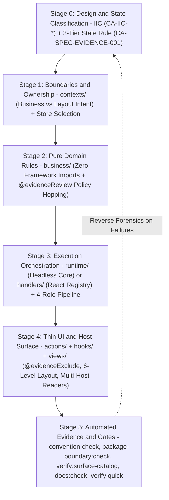

# Spec-to-Code Authoring Guide

**Status:** Active  
**Spec / Decision IDs:** `CA-SURFACE-CATALOG-001`, `CA-SPEC-EVIDENCE-001`, `CA-STATECHART-EFFECT-001`, `CA-ELEMENT-INTEROP-001`  
**Owner:** Framework Core, React Runtime & Architecture Governance  
**Related Specifications:**
- [Convention Index](./convention-index.md)
- [Implementation Convention](./implementation-convention.md)
- [Store Selection and Usage Guide](./store-selection-and-usage-guide.md)
- [Core Action Contracts](../../../packages/core/docs/action-contracts.md)
- [React State Contracts](../../../packages/react/docs/state-contracts.md)
- [Interaction Intent to Implementation Flow](./interaction-intent-implementation-flow.md)
- [Unified Triad Self-Serve Sync Guide](./triad-evidence-sync-guide.md)

Context-Action is designed so that **specification intent, domain state, execution pipelines, UI bindings, and verification gates map 1:1 to distinct code locations**. Rather than jumping between seven separate manuals before writing a feature, use this guide as the single end-to-end blueprint connecting specs to idiomatic Context-Action code.

---

## 1. End-to-End Spec-to-Code Pipeline



---

## 2. Spec-to-Layer-to-Gate Mapping Matrix

| Authoring Stage | Target Directory / Artifact | Core Coding Rule | Authoritative Spec | Enforcement Scope & Gate |
| --- | --- | --- | --- | --- |
| **Stage 0 · Intent & Tiering** | Design spec / PR / `@evidence*` | Record UX shortcuts & fallback signals (`CA-IIC-*`); apply **2-Second State Rule** (`Tier 1` TypeSpec + `@evidenceReview`, `Tier 2` client rules/activity, `Tier 3` volatile UI waived) | [IIC Flow](./interaction-intent-implementation-flow.md), [CA-SPEC-EVIDENCE-001](./decisions/CA-SPEC-EVIDENCE-001.md) | **Advisory / Cross-Repo** (fail-closed when running sibling `ttsc-ex` / `oa-sdk` Policy Hopping checks) |
| **Stage 1 · Boundaries & Store Selection** | `contexts/` (`*Contexts.tsx`, `*Context.ts`) | Separate **`BusinessActionIntent`** from **`LayoutActionIntent`** (**No Mixed Payloads**); choose progressive adoption level (`Level 1 Lite`, `Level 2 Standard Headless-First DI`, `Level 3 Enterprise 6-Layer`); pick primitive from Store matrix | [Store Selection Guide](./store-selection-and-usage-guide.md), [Triad Sync Guide](./triad-evidence-sync-guide.md) | **CI-Enforced**: `pnpm convention:check`, `pnpm package-boundary:check` |
| **Stage 2 · Pure Domain Logic** | `business/` (`*Draft.ts`, `*Validation.ts`, `*Result.ts`, `*Activity.ts`, `*StateMachine.ts`) | **Zero React & `@context-action/*` imports**; pure `state + event -> nextState` transitions; no UI copy or DOM calls; emit structured domain events instead of UI strings | [Implementation Convention](./implementation-convention.md), [Explicit State Machine](./patterns/explicit-state-machine.md) | **CI-Enforced**: `pnpm convention:check` (`business/` filename + import boundary rules) |
| **Stage 3A · Headless Engine (Optional)** | `runtime/` (`create*.ts`, `*.test.ts`) | Pure TypeScript engine assembly (`ActionRegister` + `createStore` / `createStateStore` / `TimeTravelStoreManager`) runnable in Node/Workers/Preact/Lit; **zero `react`/`react-dom` or React layer imports**; test directly without DOM | [Context-Layered Guide](./context-layered-guide.md), [Headless-First Showcase](/en/examples/basic-setup) | **CI-Enforced**: `pnpm convention:check` (`runtime/` `.ts` naming + zero React/UI imports) |
| **Stage 3B · React Orchestration** | `handlers/` (`*HandlerRegistry.tsx`, `use*Handlers.tsx`, `*HandlerSupport.ts`) | Three-step commit loop (`getValue()` -> `business/` -> `setValue()`/`update()`); use **4-role hooks**; coordinate multi-store atomic undo via `StoreTransactionCoordinator` / `bindActionTransactions`; hydrate decoupled `@entityRoot` + `@aspectOf` storage via `Promise.allSettled` | [Core Action Contracts](../../../packages/core/docs/action-contracts.md), [React State Contracts](../../../packages/react/docs/state-contracts.md) | **CI-Enforced**: `pnpm convention:check` (forbids direct `use*ActionGuard`/`CommandHandler`/`Observer`/`ResultHandler`/`ActionHandler` outside `handlers/` and enforces `Action -> Store -> Ref -> Registry` nesting) |
| **Stage 4 · Thin Surface & Host Bridges** | `actions/`, `hooks/`, `views/` (`.tsx`) | `actions/` exposes semantic commands (hides raw `dispatch`); `hooks/` computes derived view models via `StoreReader`; `views/` has top-of-file `@evidenceExclude`, zero `runtime/`/`business/`/`handlers/` runtime imports, 6-Level layout hierarchy, 4-Tier semantic Z-Index (`--z-base`..`--z-toast`); bridge Preact/Lit read-only | [Folder Structure](./architecture/folder-structure.md), [CA-ELEMENT-INTEROP-001](./decisions/CA-ELEMENT-INTEROP-001.md) | **CI-Enforced**: `pnpm convention:check`, `pnpm --filter example check`, `pnpm verify:element-interop` |
| **Stage 5 · Catalog, Docs & Receipt** | `catalog/repository-surface/*.json`, paired `docs/{en,ko}/**`, `.verification/local-receipt.json` | Update paired EN/KO docs, `api/example/document-surface.v1.json`, `docs/{en,ko}/llms/llms-*.txt` (`pnpm docs:llms`), and compile-checked `<!-- @context-action-compile -->` blocks; mint local receipt on clean commit | [Documentation Conventions](../concept/documentation-development-conventions.md), [CA-SURFACE-CATALOG-001](./decisions/CA-SURFACE-CATALOG-001.md) | **CI-Enforced**: `pnpm verify:surface-catalog`, `pnpm verify:doc-snippets`, `pnpm docs:check`, `pnpm verify:quick`, `pnpm verify:receipt` |

---

## 3. Recommended 4-Role Action API Hierarchy

Context-Action distinguishes four explicit execution roles inside an Action Pipeline (`Admission -> Execution & Result -> Settlement`). Prefer the dedicated role APIs for structured workflows so admission checks, state commits, return values, and post-settlement telemetry cannot accidentally mix responsibilities:

| Tier | Core `ActionRegister` API | React `ActionContext` Hook | Intended Responsibility |
| --- | --- | --- | --- |
| **Canonical · Guard (Admission)** | `registerGuard(action, fn, config)` | `useActionGuard` | Validate payloads/permissions before mutation; short-circuit via `controller.abort()`. |
| **Canonical · Command (Execution)** | `registerCommand(action, fn, config)` | `useActionCommandHandler` | Execute domain work and commit stores (`getValue()` -> `business/` -> `setValue()`/`update()`). |
| **Canonical · Result (Value Return)** | `registerResult(action, fn, config)` | `useActionResultHandler` | Compute typed return values collected by `dispatchWithResult()`. |
| **Canonical · Observer (Observation)** | `registerObserver(action, fn, config)` | `useActionObserver` | Observe settled outcomes (`event.result`, `event.outcome`) for logs/telemetry/UI sync with zero abort or return authority. |
| **Lite / Compatibility** | `register(action, fn, config)` | `useActionHandler` | General-purpose hook allowed for Level 1 Lite features or legacy migration. |
| **Deprecated Transitional** | `registerEffect(action, fn, config)` | `useActionEffectHandler` | **Deprecated.** Migrate `effectKind: 'guard'` to `useActionGuard` and `effectKind: 'observer'` to `useActionObserver`. |

---

## 4. End-to-End Authoring Walkthrough (Spec -> Headless Runtime -> React DI)

The following compile-checked snippet demonstrates the recommended **Headless-First Symmetric DI** pattern combining separated intents (`BusinessActionIntent` vs `LayoutActionIntent`), pure `business/` validation/calculation, a zero-React `createStateStore` + `ActionRegister` 4-role pipeline, and `ownership="shared"` React Context injection:

<!-- @context-action-compile -->
```tsx
import { ActionRegister, type ActionPayloadMap } from '@context-action/core';
import { createStateStore, type StateMutationMeta } from '@context-action/store-core';
import {
  createActionContext,
  createStore,
  createStoreContext,
  useStoreValue,
} from '@context-action/react';
import { createBackendStore } from '@context-action/react/backend';

// Stage 1: Separate BusinessActionIntent from LayoutActionIntent (No Mixed Payloads)
interface OrderBusinessActions extends ActionPayloadMap {
  submitOrder: { sku: string; qty: number };
}

interface OrderResultMap {
  submitOrder: { accepted: boolean; total: number };
}

interface OrderLayoutActions extends ActionPayloadMap {
  toggleSummaryDrawer: { open?: boolean };
}

interface OrderState {
  readonly lastSku: string | null;
  readonly total: number;
  readonly error: string | null;
}

// Stage 2: Pure business/ rules (zero framework imports)
function validateOrderInput(sku: string, qty: number): string | null {
  if (!sku.trim()) return 'SKU is required.';
  if (qty <= 0) return 'Quantity must be positive.';
  return null;
}

function computeOrderTotal(qty: number): number {
  return qty * 25;
}

// Stage 3A: Pure-TS Headless runtime/ assembly (runnable in Node, Workers, Preact, Lit, React)
export function createHeadlessOrderRuntime() {
  const initialOrder: OrderState = { lastSku: null, total: 0, error: null };
  const orderStore = createStore<OrderState>('order', initialOrder);
  const telemetryBackend = createStateStore('telemetry', { completedCount: 0 });
  const telemetryReactStore = createBackendStore('telemetry', telemetryBackend, {
    ownership: 'shared',
  });

  const register = new ActionRegister<OrderBusinessActions, OrderResultMap>({
    name: 'OrderEngine',
  });

  // Guard (Admission): validate before state mutation
  register.registerGuard(
    'submitOrder',
    ({ sku, qty }, controller) => {
      const error = validateOrderInput(sku, qty);
      if (error) {
        orderStore.update((prev) => ({ ...prev, error }));
        controller.abort(error);
      }
    },
    { id: 'order-input-guard', priority: 100 },
  );

  // Command / Result: compute pure logic and commit state
  register.registerResult(
    'submitOrder',
    ({ sku, qty }) => {
      const total = computeOrderTotal(qty);
      orderStore.setValue({ lastSku: sku.trim(), total, error: null });
      return { accepted: true, total };
    },
    { id: 'order-submit-command', priority: 10 },
  );

  // Observer: react after pipeline settlement without controller or return authority
  register.registerObserver(
    'submitOrder',
    (event) => {
      if (event.outcome === 'completed') {
        const meta: StateMutationMeta = { origin: 'system', label: 'order-settled' };
        telemetryBackend.update((prev) => ({ completedCount: prev.completedCount + 1 }), meta);
      }
    },
    { id: 'order-audit-observer', priority: 1 },
  );

  const LayoutActions = createActionContext<OrderLayoutActions>('OrderLayout');
  const BusinessActions = createActionContext<OrderBusinessActions, OrderResultMap>('OrderBusiness');
  const OrderStores = createStoreContext('OrderStores', {
    order: { initialValue: initialOrder },
    // Tier 3 volatile presentation state waived from TypeSpec
    drawerOpen: false,
  });

  return {
    orderStore,
    telemetryReactStore,
    register,
    BusinessActions,
    LayoutActions,
    OrderStores,
  };
}

const runtime = createHeadlessOrderRuntime();

// Stage 4: Thin React View with Symmetric DI (ownership="shared")
function OrderPanel() {
  const dispatch = runtime.BusinessActions.useActionDispatch();
  const orderStore = runtime.OrderStores.useStore('order');
  const order = useStoreValue(orderStore);
  const telemetry = useStoreValue(runtime.telemetryReactStore);

  return (
    <button
      type="button"
      onClick={() => void dispatch('submitOrder', { sku: 'CA-BOOK', qty: 2 })}
    >
      Last Total: {order.total} (Completed: {telemetry.completedCount})
    </button>
  );
}

export function OrderFeature() {
  return (
    <runtime.BusinessActions.Provider register={runtime.register} ownership="shared">
      <runtime.OrderStores.Provider
        stores={{ order: runtime.orderStore }}
        ownership="shared"
      >
        <OrderPanel />
      </runtime.OrderStores.Provider>
    </runtime.BusinessActions.Provider>
  );
}
```

> **Progressive Adoption Rule:** Small local UI features can start at **Level 1 Lite** with `createActionContext` + `createStoreContext` + `useActionHandler`. Move domain rules into `business/` and headless `runtime/` as soon as validation/state transitions should be tested outside React or shared across host frameworks.

---

## 5. Multi-Host Store Reader Bridges (`React` · `Preact` · `Lit`)

When sharing one headless `StateStore` (`@context-action/store-core`) or `@context-action/react` `Store` across multiple UI runtimes, note the exact structural `getSnapshot()` shape expected by each host adapter:

| Host Adapter | Reader Contract | `getSnapshot()` Return Shape | Explicit Bridge Needed? |
| --- | --- | --- | --- |
| **React** (`@context-action/react`, `@context-action/react/backend`) | `StoreReader<T>` / `StateReader<T>` | `Snapshot<T>` (`{ value, name, lastUpdate, version? }`) | No for `Store` / `TimeTravelStore`; wrap custom `StateBackend` with `createBackendStore()` |
| **Preact Signals** (`@context-action/preact`) | `ReadableSource<T>` | **Raw value `T`** | Use **`fromStateReader(reader)`** to unwrap `{ value: T }` cleanly into `ReadableSource<T>` |
| **Lit** (`@context-action/lit`) | `ReadableStore<T>` | `getValue(): T` (+ `subscribe`) | No for `Store`, `TimeTravelStore`, or `createStateStore()` |

Because a domain state `T` might itself contain a `.value` property, `@context-action/preact` intentionally avoids ambiguous `'value' in snapshot` duck-typing inside `connectSourceSignal()` and provides an explicit `fromStateReader()` adapter instead:

```ts
import { createStateStore } from '@context-action/store-core';
import { connectSourceSignal, fromStateReader } from '@context-action/preact';
import { StoreController } from '@context-action/lit';

// One framework-neutral store owned outside UI runtimes
export const sharedSessionStore = createStateStore('session', { step: 1 });

// 1. Preact Signals read-only projection (explicit unwrapping via fromStateReader)
export const preactSession = connectSourceSignal(fromStateReader(sharedSessionStore));

// 2. Lit ReactiveController projection (directly accepts StateStore because it implements getValue + subscribe)
// Inside a LitElement host:
// private session = new StoreController(this, sharedSessionStore);
```

---

## 6. Progressive Adoption, Defect Prevention & Debt Governance

Avoid over-engineering simple UI widgets while guaranteeing strict invariants once workflows scale.

### 6.1 3-Level Progressive Adoption Matrix

| Adoption Level | Minimal Directory Shape | Required Primitives | Promote Next When… |
| --- | --- | --- | --- |
| **Level 1 · Lite** | `contexts/`, `handlers/`, `views/` | `createActionContext` + `createStoreContext` + `useActionHandler` | Business validation or async transitions need unit testing outside React |
| **Level 2 · Headless-First Symmetric DI** | Add `business/`, pure-TS `runtime/` | `ActionRegister` + `createStateStore`/`createStore` + `ownership="shared"` Providers | Multiple UI views/runtimes (`React`, `Preact`, `Lit`, Workers) share the same engine |
| **Level 3 · Full 6-Layer** | Full `contexts / business / runtime (opt.) / handlers / actions / hooks / views` | Separated `Business` vs. `Layout` ActionContexts, `RefContext`, 4-role hooks, structured FSM/events | Teams enforce long-lived domain contracts, IIC traceability, and TypeSpec Evidence (`packages/template-react` starter) |

### 6.2 What Each Pattern Induces (Intent & Quality Guarantees)

- **Handler-only lazy reads (`no-store-subscription-in-handlers`) + `useCallback`**: Prevents stale-closure reads, unintended handler unregistration/re-registration churn, and circular re-render loops.
- **Dispatch-only `actions/` helpers (`no-store-access-in-actions`)**: Keeps components unable to bypass Guards or Observers with ad-hoc `store.setValue()` mutations.
- **Separated `BusinessActionIntent` vs. `LayoutActionIntent`**: Stops ephemeral layout events (`drawerToggle`, `focusField`) from triggering business analytics, persistence, or TimeTravel undo entries.
- **Structured domain codes & events in `business/` → UI text mapping in `hooks/`**: Ensures domain tests and analytics remain immune to UX wording changes and keeps localization in the binding layer.
- **Explicit Debt Ledgers (`layered-surface-classification.json` & `rule-exceptions.json`)**: Every allowed deviation must declare a non-empty rationale and fails closed once stale, stopping architectural rot before it spreads.

---

## 7. Canonical Live Examples & Verification Checklist

Inspect these live repository implementations that prove different slices of the architecture:

- **Canonical Starter Template (`OrderWorkspace`, 6-Layer + Core 3 Axes + 4-Role Pipeline):**
  - `@context-action/template-react` (`packages/template-react/src/features/order-workspace/`)
- **Enterprise 6-Layer Playbooks (React Registry + Business + Explicit FSM + IIC):**
  - `/patterns/implementation-playbook` (`example/src/pages/patterns/implementation-playbook/`)
  - `/patterns/implementation-playbook/access-request`
  - `/patterns/implementation-playbook/incident-escalation`
  - `/patterns/implementation-playbook/renewal-risk-review`
- **Headless-First Symmetric DI (`runtime/` + `ownership="shared"` React DI):**
  - `/foundations/react/headless-di` (`example/src/pages/foundations/react/headless-di/`)
- **Tool-Calling AI Workspace (`tool-protocol` + `ai-sdk` + `webmcp` + `tool-durable-operations`):**
  - Standalone `/web-coding/` (`demos/bolt-style-editor/`)

Before opening a PR (or validating external starter projects with `--root`), run the matching gates from the repository root:

```bash
pnpm convention:check
node scripts/check-context-layered-conventions.mjs --root packages/template-react/src
pnpm package-boundary:check
pnpm verify:surface-catalog
pnpm verify:doc-snippets
pnpm docs:check
pnpm verify:quick
pnpm verify:receipt
```
