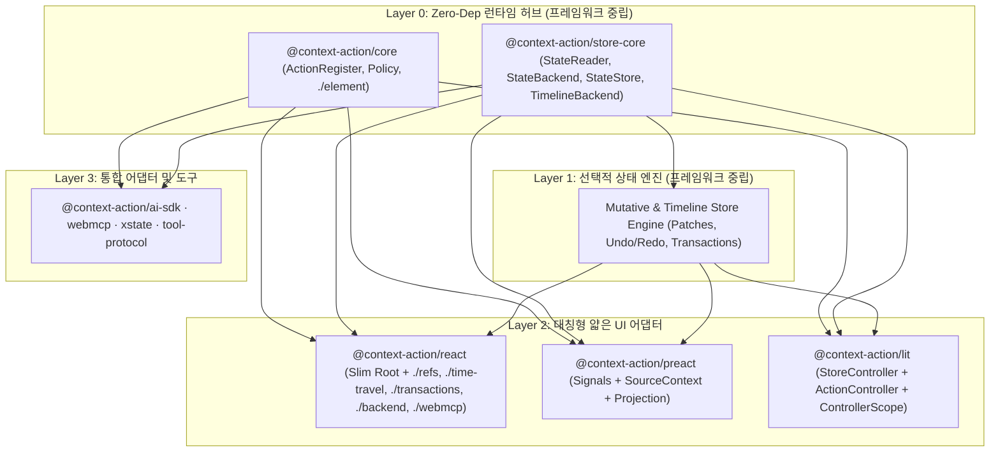

# CA-VNEXT-ARCHITECTURE-001: vNext Hub-and-Spoke API, 상태 계층 통합 및 React 표면 슬림화 청사진

**상태:** proposed — Phase 1 (4.x 무중단) 실행 계획 수립 완료, 7개 소비자 저장소 교차 감사 완료 (본 문서로 런타임 코드 변경 미적용)  
**소유자:** Framework Core & React Runtime  
**관련 이슈/스펙:** `CA-VNEXT-ARCHITECTURE-001` ([CA-SURFACE-CATALOG-001](./CA-SURFACE-CATALOG-001.md), [CA-ELEMENT-INTEROP-001](./CA-ELEMENT-INTEROP-001.md), [CA-STATECHART-EFFECT-001](./CA-STATECHART-EFFECT-001.md), [CA-SPEC-EVIDENCE-001](./CA-SPEC-EVIDENCE-001.md) 기반)  
**기준선(Baseline):** `stage` @ `d21aff4a` (`@context-action/core@1.3.1`, `@context-action/store-core@0.1.4`, `@context-action/mutative-core@0.8.14`, `@context-action/mutative@0.8.15`, `@context-action/react@4.0.7`, `@context-action/lit@0.1.4`, `@context-action/preact@0.1.3`)

---

## 1. 맥락 및 타 프로젝트 병행 작업 안내

현재 타 프로젝트 및 연계 워크스페이스에서도 기존 공개 `@context-action/*` 계약에 맞춰 수정이 진행 중이므로, 검증 완료된 현재 API 표면이나 런타임 동작을 즉시 바꾸면 교차 프로젝트 간 드리프트가 발생할 수 있습니다.

따라서 이 문서는 `stage` 안정화 과정에서 확인된 실증 근거와 구조적 긴장을 **비규범적(non-normative) `proposed` 아키텍처 청사진**으로 정제해 고정한 설계 레퍼런스입니다. **이 문서 작업에서는 소스 코드, `package.json`, 또는 표면 카탈로그를 일절 수정하지 않으며**, 실제 코드 반영은 섹션 6의 의사결정 합의와 교차 프로젝트 동기화 윈도우가 열린 이후 별도 `accepted` ADR로 진행합니다.

---

## 2. 검증된 1차 출처(Primary-Source) 근거 인벤토리

본 청사진의 모든 문제 진단과 수치는 안정화된 `stage` (`d21aff4a`) 코드베이스에서 직접 확인한 근거에 기반합니다:

| 분석 축 | 관찰 사실 및 구조적 긴장 | 실제 코드 출처 (검증됨) |
|---|---|---|
| **패키지 규모·표면 비대칭** | `@context-action/core`는 zero-dependency 액션 제어 평면(`ActionRegister.ts`: 3,394줄)과 격리된 서브패스(`.`, `./element`, `./element/react`)로 유지됩니다. 후속 어댑터인 `@context-action/lit`(31줄, 컨트롤러 3종)과 `@context-action/preact`(6줄, 프리미티브 4종)은 매우 얇은 반면, `@context-action/react`는 5개 서브패스(`.`, `./backend`, `./advanced`, `./utils`, `./webmcp`), 102줄 루트 배럴, 그리고 구체 `Store`(1,057줄)와 `BackendStore`(376줄)를 함께 품고 있습니다. | `catalog/repository-surface/api-surface.v1.json`, `packages/core/package.json`, `packages/core/src/ActionRegister.ts`, `packages/react/package.json`, `packages/react/src/index.ts:1-102`, `packages/react/src/stores/core/Store.ts:1-1057`, `packages/react/src/stores/core/BackendStore.ts:1-376`, `packages/lit/src/index.ts:1-31`, `packages/preact/src/index.ts:1-6` |
| **축 1: 상태 프리미티브·어댑터 계보 파편화** | `@context-action/store-core`(구현 92줄, 계약 102줄)가 이미 프레임워크 중립 계약(`StateReader<T>`, `StateWriter<T>`, `StateBackend<T>`, `StateStore<T>`, `TimelineBackend<T>`, `TransactionBackend<T>`)을 정의하고 있습니다. 그럼에도 `@context-action/react`의 `useStoreValue`는 `IStore<any>`를, `createStoreContext().Provider stores={...}`(`ExternalStoresMap<T>`)는 `@context-action/mutative`에 결합된 구체 `Store<T[K]>`를 요구해 `store-core`의 `StateStore<T>`를 직접 주입할 수 없습니다(`@context-action/react/backend`의 376줄 `BackendStore` 어댑터가 별도로 필요). 한편 Lit은 `ReadableStore<T>`, Preact는 `ReadableSource<T>`·`SnapshotStateReader<T>`·`fromStateReader()`를 자체 정의합니다. | `packages/store-core/src/contracts.ts:36-95`, `packages/store-core/src/index.ts:28-92`, `packages/react/src/stores/core/contracts.ts:12-38`, `packages/react/docs/state-contracts.md:62-97`, `packages/react/src/stores/hooks/useStoreValue.ts:60-92`, `packages/react/src/stores/patterns/declarative-store-pattern-v2.tsx:145-147`, `packages/react/src/stores/core/Store.ts:1,105,874`, `packages/react/src/backend.ts:1-30`, `packages/lit/src/types.ts:29-51`, `packages/preact/src/source-signal.ts:19-40` |
| **축 1b: 동기 알림 vs RAF 배칭 기본값 불일치** | `store-core`의 `createStateStore()`는 동기 commit 및 즉시 listener 알림을 수행하지만, `@context-action/react`의 `Store<T>`는 `notificationMode` 기본값이 `'batched'`(16ms `requestAnimationFrame` 스케줄링)로 설정되어 있어 헤드리스/테스트 환경에서도 16ms RAF 틱 또는 `waitFor()` 대기가 필요합니다. | `packages/react/src/stores/core/Store.ts:105,874`, `packages/store-core/src/index.ts:50-61`, `example/src/pages/performance/action-guard/scroll/ScrollHandlerRegistry.test.tsx:88-140` |
| **축 2: Core vs React 큐 기본값 역전 및 교착 위험** | `ActionRegister`는 `config.registry?.useConcurrencyQueue === true`일 때만 직렬 큐를 켜고 재진입 규칙을 명시(`packages/core/docs/action-contracts.md`)하지만, `@context-action/react`의 `createActionContext`는 `?? true`로 기본값을 뒤집습니다. 실제로 `stage` 안정화(`c07882b1`) 중 `template-react`의 `resetDraft`/`retrySubmission`과 `FlowControlActions`의 `recordExecutionStep`/`recordHandlerExecution`에서 교착이 확인되어 호출부에 `{ immediate: true }`와 `void` 페이로드용 `undefined` 자리 채우기를 수동 추가해야 했습니다. | `packages/core/src/ActionRegister.ts:322`, `packages/core/src/types.ts` (`DispatchArgs`), `packages/core/docs/action-contracts.md:43-60`, `packages/react/src/actions/ActionContext.tsx:314`, `packages/template-react/src/features/order-workspace/actions/useOrderActions.ts:17-30`, `example/src/pages/patterns/pipeline/actions/FlowControlActions.tsx:30-39` |
| **축 2b: 디스패치 훅 비대칭 & Level 1↔2 2중 선언** | `useActionDispatch()`는 단일 함수를 반환하는 반면 `useActionDispatchWithResult()`는 `{ dispatch, dispatchWithResult, abortAll, resetAbortScope }` 4개 필드 객체를 반환해 API 형태가 비대칭입니다. 또한 Level 1 Lite에서 Level 2 Headless-First Symmetric DI로 전환할 때 `ActionRegister`+`createStore` 선언과 `createActionContext`+`createStoreContext` 선언을 중복 작성하고 `ownership="shared"` Provider를 중첩 배선해야 합니다. | `packages/react/src/actions/ActionContext.types.ts:123,177-182`, `packages/react/__tests__/patterns/right-sized-adoption.integration.test.tsx:186-248,310-323` |
| **축 3: `@context-action/react` 루트 표면 비대화 및 Legacy 잔존** | `packages/react/src/index.ts` 루트(`.`)에 Action, Store, TimeTravel, Transactions(`StoreTransactionCoordinator`, `ActionTransactionBridge`), `StoreErrorBoundary`, `RefContext`, `ActionRegister`, React 헬퍼와 deprecated 심볼(`useActionEffectHandler`, `StoreConfig.compareStrategy`, `StoreSchema`, 레거시 `TransactionBackend`)이 한데 혼재해 있습니다. | `packages/react/src/index.ts:1-102`, `packages/react/src/actions/ActionContext.types.ts:137-150`, `packages/react/src/stores/patterns/declarative-store-pattern-v2.tsx:53,136`, `packages/react/src/stores/core/contracts.ts:26-38` |

### 2.1 교차 프로젝트 소비자 감사 근거 (7개 실사용 저장소)

`@context-action/*`를 실제 소비 중인 워크스페이스 7곳을 읽기 전용으로 감사해 위 구조적 긴장과 대조한 결과입니다:

| 소비자 저장소 | 의존 패키지 / 버전 | 실사용 패턴 및 마찰 근거 (검증됨) |
|---|---|---|
| **`browser-studio`** | `@context-action/core@^1.3.1`, `@context-action/store-core@^0.1.4`, `@context-action/xstate@^0.1.0` *(React 미사용)* | • `TimeTravelStore`가 `@context-action/react`에 묶여 있어 `createStateStore()` 위에 수동 `history[]` + `historyCursor` + `structuredClone` Undo/Redo를 직접 구현 중입니다 (`browser-studio/packages/blueprint-core/src/blueprint-graph-context.ts:125-126,588-619,1489-1561`).<br>• `SyncActionPipeline` + `StateStore` 조합을 위해 커스텀 `SyncCommandMethods`·`defineEditorContextSpec` 글루를 자체 구성했습니다 (`browser-studio/packages/editor-platform-core/src/contexts/shared.ts:86-90`). |
| **`google-tools`** (`video-prompt-book-studio`, `video-prompt-book-ui`) | `@context-action/core@^1.3.1`, `@context-action/store-core@^0.1.4`, `@context-action/lit@^0.1.4`, `@context-action/lit-ui@^0.1.4` | • 프레임워크 중립 `{ store: StateStore, actions: ActionRegister, dispose }` 런타임을 `@context-action/lit-ui`(`createStoreContext` + `ContextStoreController`)에 직결합니다. Lit은 `StateStore`를 네이티브 수용하는 반면 React는 `BackendStore` 래퍼가 필요한 비대칭이 확인되었습니다 (`src/domain/runtime.ts:1-24`, `src/components/studio-context.ts:1-30`). |
| **`macrostructure-first-reference-v0.4.0`** | `@context-action/core@^1.1.0`, `@context-action/react@3.0.0`, `@context-action/lit@^0.1.3`, `@context-action/lit-ui@^0.1.3` | • React `useStoreValue`가 `StateReader<T>`를 직접 받지 못해 `useRef`에 미러 `createStore`를 만들고 `useEffect`로 스냅샷을 수동 복사하는 우회 코드를 사용 중입니다 (`src/runtime/interface-intent-runtime-react.ts:15-32`).<br>• `lit@0.1.3`·`lit-ui@0.1.3` 기준 SSR/hydration 요청은 모두 종결되었습니다 (`docs/proposals/context-action-lit-hydration-request.md:159`). |
| **`houdini-flow`** | `@context-action/core@^1.3.0` | • React 없이 순수 `ActionRegister<PayloadMap, ResultMap>` + 커스텀 `HoudiniFlowStore`로 동작하며 Layer 0 Core의 zero-dep 순수성이 필수임을 뒷받침합니다 (`src/pipeline/actions.ts:7-88`). |
| **`clip-spike-react/packages/ae-editor`** | `@context-action/core@^0.8.6`, `@context-action/react@^0.8.6` | • `src/context/contexts.ts:1,189,198`에서 `@context-action/react` 루트(`.`)로부터 `createActionContext`, `createStoreContext`, `createTimeTravelStoreContext`를 import하며, 순수 Node `.mjs` 모델 테스트(`test/editor-history-model.test.mjs:5`, `test/clip-authoring-store-model.test.mjs:5`)에서도 `createTimeTravelStore`를 `@context-action/react`에서 가져다 씁니다. |
| **`iframe-gsap-studio/packages/iframe-demo`** & **`webs/packages/graph-hub`** | `@context-action/react@^0.8.3` / `latest` | • `createActionContext`, `createStoreContext`, `useStoreValue`, `ActionPayloadMap`을 모두 `@context-action/react` 루트(`.`)에서 직접 import하므로 4.x 기간 동안 루트 호환성 유지가 필수입니다. |
| **병행 `packages/react` 4.x 작업 (진행 중)** | `@context-action/react` 4.x 미출시 작업 | • `'batched'` 기본값을 깨지 않으면서 `notificationMode?: 'batched' | 'immediate'`(`StoreOptions`/`StoreNotificationMode`), `useRefController`, `useDebugValue`, `useLocalStore` 내 `useId()`를 무중단으로 추가 중입니다 (`packages/react/UNRELEASED.md:6-10`). |

---

## 3. 목표 아키텍처: 대칭형 Hub-and-Spoke 구조

vNext 목표 구조는 **액션 파이프라인과 상태 읽기/쓰기 계약을 프레임워크 중립 Layer 0 허브에 배치**하고, 선택적 스냅샷/타임라인 엔진을 Layer 1에 분리한 뒤, React·Preact·Lit이 동일한 계약을 얇게 어댑팅하는 대칭형 Hub-and-Spoke 모델입니다.



| 계층 | 소유 책임 | 명시적 비목표 (Non-Goals) |
|---|---|---|
| **Layer 0: 런타임 허브** | 프레임워크 중립 `ActionRegister` 파이프라인, `DispatchArgs`/정책 계약, DOM 인터롭(`./element`), 정규 `StateReader` / `StateBackend` / `StateStore` / `TimelineBackend` / `TransactionParticipantBackend` 계약 | 기본 `.` 엔트리에 React·Preact·Lit·DOM 런타임 의존성 유입 금지 ([CA-ELEMENT-INTEROP-001](./CA-ELEMENT-INTEROP-001.md)) |
| **Layer 1: 상태 엔진** | 선택적 불변 패치 생성, CoW 구조 공유, undo/redo 타임라인, `StateBackend`·`TimelineBackend` 기반 원자적 멀티 스토어 트랜잭션 | React `useSyncExternalStore`나 컴포넌트 트리에 직접 결합 금지 |
| **Layer 2: UI 어댑터** | 프레임워크 생명주기 바인딩(`Provider`, `ReactiveController`, `SignalConnection`), DI 소유권(`ownership="shared" | "owned"`), 훅/프로젝션 연결 | 다른 프레임워크에서 재사용 불가능한 독점 Store 구현체 소유 지양 |
| **Layer 3: 통합 및 도구** | XState, WebMCP, AI SDK v7, Zod 기반 도구 프로토콜 어댑팅 ([CA-STATECHART-EFFECT-001](./CA-STATECHART-EFFECT-001.md), [CA-SURFACE-CATALOG-001](./CA-SURFACE-CATALOG-001.md)) | Action 승인 단계 우회 또는 Provider SDK 타입의 Core 유출 금지 |

---

## 4. 검토한 선택지 및 트랙별 상세 청사진

> **참고:** 섹션 4의 TypeScript 예제는 후보 API를 보여주기 위한 **비규범적 설계 스케치**이며, 현재 배포/빌드된 패키지에 존재하지 않습니다.

### 4.1 트랙 A — State / Store 계약 통합 설계

#### 선택지 A1 *(우선 권장 기반)*: React 훅과 `createStoreContext`에서 `StateReader<T>` / `StateBackend<T>` 직접 수용
- `useStoreValue`, `useStoreSelector`, `ExternalStoresMap<T>`의 입력 제약을 구체 React `Store` / `IStore`에서 **`StateReader<T>` / `StateBackend<T>` 계약**으로 확장하여 `@context-action/store-core`, `@context-action/react`, `@context-action/lit`(`ReadableStore`), `@context-action/preact`(`SnapshotStateReader`)를 하나의 구조적 능력 사다리(`StateReader` → `StateBackend` → `TimelineBackend`)로 통합합니다.
- 효과: `createStateStore()`로 만든 zero-dep 헤드리스 스토어를 수동 `BackendStore` 래핑 없이 React `createStoreContext().Provider`와 구독 훅에 바로 주입할 수 있습니다.

#### 선택지 A2 *(구조적 추출)*: Mutative `Store` 및 `TimeTravelStore`를 React에서 탈결합
- `packages/react/src/stores/core/` 내부의 Mutative/TimeTravel 엔진을 프레임워크 중립 Layer 1 모듈 또는 `@context-action/mutative` 측으로 분리해 Lit·Preact와 공유하고, `@context-action/react`에서는 하위 호환 re-export를 유지하는 방향입니다.
- **기각된 대안:** `@context-action/store-core`를 폐기하고 `@context-action/react`를 단일 상태 패키지로 통합. Lit·Preact·Vanilla JS·Worker 환경은 React 18/19 peer 의존성이 없는 상태 계약이 필수적이므로 기각했습니다.

#### 핵심 트레이드오프: 기본 알림 모드(`'batched'` RAF vs. `'immediate'`)
- **`'batched'`(16ms RAF) 기본값 유지:** 연속 업데이트를 자동 프레임 스로틀링해 기존 대시보드 패턴을 깨지 않지만, 헤드리스/테스트에서도 RAF 대기가 필요한 비직관성이 남습니다 ([모범 사례](../../guide/best-practices.md)).
- **`'immediate'` 기본값 전환 + 명시적 `'raf'` / `RefContext` 분리:** `createStateStore()`와 동일한 동기 commit/알림을 기본으로 두고, React 배칭은 React 18/19에 맡기며, 60fps 고빈도 DOM 제어는 `RefContext`([Store 선택 가이드](../store-selection-and-usage-guide.md))로 유도합니다. 전환 시 **semver-major 행위 변경**으로 다뤄야 합니다.

---

### 4.2 트랙 B — Authoring DX 및 액션 정책 선언 설계

#### B1. Action 계약 레벨의 큐/스케줄링 정책 선언

호출부마다 `dispatch('resetDraft', undefined, { immediate: true })`를 기억하게 하는 대신, 레지스트리 계약에 액션별 스케줄링 정책을 선언하는 방향입니다.

```ts
// 비규범적 설계 스케치 (현재 미구현)
const register = new ActionRegister<OrderActions, OrderResults>({
  name: 'OrderBusiness',
  actions: {
    submitOrder:     { queue: 'serial', timeout: 10_000 },
    resetDraft:      { queue: 'immediate' },
    retrySubmission: { queue: 'immediate' },
    recordStep:      { queue: 'immediate' },
  },
});

// 호출부: void 페이로드 자리 채우기 및 옵션 누락 위험 제거
await dispatch('resetDraft');
```

- **기본값 정합성 과제:** `@context-action/core`(`useConcurrencyQueue` 기본 `false`)와 `@context-action/react`의 `createActionContext`(`useConcurrencyQueue` 기본 `true`) 간 역전을 맞추면 헤드리스 테스트와 React 마운트 환경 간 동작 차이를 없앨 수 있습니다.

#### B2. Dispatch 훅 시그니처 대칭화
- **선택지 B2-a *(함수형 대칭 권장)*:** `useActionDispatch()`는 `dispatch` 함수를, 신규 `useActionResultDispatch()`는 `dispatchWithResult` 함수를 반환해 1:1 함수형으로 통일(`useActionDispatchWithResult()`는 4.x deprecated 유지)하고, 취소 제어는 `useActionScope()` (`{ abortAll, resetAbortScope }`)로 분리합니다.
- **선택지 B2-b *(호출 가능 객체 확장)*:** `dispatch.withResult(...)` 형태로 단일 훅에 메서드를 부착합니다. 간결하지만 TypeScript 모킹 및 훅 린트 관습과 충돌 소지가 있습니다.

#### B3. Level 1 ↔ Level 2 전환 비용을 줄이는 선택적 통합 바인딩 (`defineRuntime` / `bindReactRuntime`)

```tsx
// 비규범적 설계 스케치 (현재 미구현)
const CouponRuntime = defineRuntime({
  name: 'Coupon',
  actions: defineActions<CouponActions, CouponResults>({
    clearCoupon: { queue: 'immediate' },
  }),
  stores: {
    subtotal: () => createStateStore('subtotal', 100),
    quote: () => createStateStore<CouponQuote>('quote', initialQuote),
  },
});

const Coupon = bindReactRuntime(CouponRuntime);

// Level 1 (Provider가 생명주기 소유)
<Coupon.Provider>
  <CouponWidget />
</Coupon.Provider>

// Level 2 (헤드리스 엔진 주입 — 뷰/핸들러 코드 수정 없음)
const engine = CouponRuntime.create();
<Coupon.Provider runtime={engine} ownership="shared">
  <CouponWidget />
</Coupon.Provider>
```

- **주의할 과추상화 방지 원칙:** `defineRuntime`을 도입하더라도 이는 **독립된 `ActionRegister` + `StateStore` 묶음을 얇게 조립하는 선택적 문법 설탕**에 그쳐야 합니다. Level 3 6-Layer 워크스페이스에서 `BusinessActionIntent`와 `LayoutActionIntent`를 두 개의 분리된 경계로 두는 원칙을 훼손해서는 안 됩니다.

---

### 4.3 트랙 C — `@context-action/react` 표면 슬림화 및 단계적 로드맵

| Entrypoint | 목표 책임 | 포함 심볼 (안) |
|---|---|---|
| `@context-action/react` (`.`) | **일상 필수 React 표면 (~12개 심볼)** | `createActionContext`, `createStoreContext`, `useStoreValue`, `useStoreSelector`, `useStorePath`, `createStore`, `ActionRegister`, `(선택) bindReactRuntime`, 핵심 타입 |
| `@context-action/react/refs` *(신규 서브패스)* | 비반응형 Tier 3 DOM / 60fps 제어 | `createRefContext`, `RefContextReturn`, `RefTarget`, `RefOperationOptions`, `RefOperationResult` |
| `@context-action/react/time-travel` *(신규 서브패스)* | Undo/Redo 타임라인 및 훅 | `createTimeTravelStore`, `createTimeTravelStoreContext`, `TimeTravelStore`, `useTimeTravelControls`, `useTimeTravelPath`, `useTimeTravelSelector` |
| `@context-action/react/transactions` *(신규 서브패스)* | 멀티 스토어 원자적 트랜잭션·인스펙터 | `StoreTransactionCoordinator`, `bindActionTransactions`, `useStoreTransactionInspector` |
| `@context-action/react/backend` *(기존)* | `store-core` 백엔드 브리지 및 계약 | `BackendStore`, `createBackendStore`, `store-core` 프로토콜 타입 |
| `@context-action/react/webmcp` *(기존)* | WebMCP 브라우저 도구 격리 노출 | 현행 격리 표면 유지 |

#### 단계별 호환성 로드맵

1. **Phase 1 — `4.x` 무중단(Additive / Non-Breaking) 개선**
   - `ActionRegister`에 액션별 스케줄링 정책(`queue: 'serial' | 'immediate'`) 옵션 추가 (기존 기본값 유지).
   - `useStoreValue` 및 `ExternalStoresMap`이 `StateReader<T>` / `StateBackend<T>`를 직접 수용하도록 타입·런타임 호환 확장 (`IStore` / `Store` 완전 호환 유지).
   - `@context-action/react/refs`, `/time-travel`, `/transactions` 서브패스 추가 및 루트 `.` re-export 병행 (구현 시 `catalog/repository-surface/api-surface.v1.json` 및 경계 게이트 동시 갱신).
   - 선택적 `defineRuntime` 도입의 실효성 검증.
2. **Phase 2 — `v5` 메이저 정식 정리 (Breaking)**
   - 기존 deprecated 심볼 제거: `useActionEffectHandler`, `StoreConfig.compareStrategy`, `StoreSchema`, 레거시 React `TransactionBackend` 파사드.
   - `@context-action/react` 루트 `.`를 핵심 프리미티브로 축소하고 특수 기능은 서브패스(`/refs`, `/time-travel`, `/transactions`)로 분리.
   - `Store` 기본 알림 모드(`immediate` vs `batched`), Core/React `useConcurrencyQueue` 기본값, `useActionDispatchWithResult` 시그니처 일관화 확정.

---

## 5. 결과 및 불변 조건 (Consequences & Invariants)

향후 본 청사진 중 일부를 실제 구현으로 승격하더라도 다음 저장소 불변 조건은 반드시 유지되어야 합니다:

- **Core 순수성 ([CA-ELEMENT-INTEROP-001](./CA-ELEMENT-INTEROP-001.md)):** `@context-action/core` 기본(`.`) 엔트리는 React, DOM, Mutative, Store 런타임 의존성을 갖지 않습니다.
- **스냅샷 버전 및 방어 읽기 보장 (`packages/react/docs/state-contracts.md`):** 상태를 소유하는 `StateBackend`는 `ReadonlyStateSnapshot<T>`에서 단조 증가 `version`을 필수 보장합니다. 버전 없는 스냅샷 허용은 명시적 호환 파사드로만 제한합니다.
- **표면 카탈로그 일치성 ([CA-SURFACE-CATALOG-001](./CA-SURFACE-CATALOG-001.md)):** 모든 신규 서브패스, 패키지 분리, export 변경은 `catalog/repository-surface/api-surface.v1.json`, 패키지 문서, `pnpm package-boundary:check` 테스트와 함께 갱신합니다.
- **독립 프리미티브 조합성:** Level 1/2 편의 팩토리를 도입하더라도 `ActionRegister`가 Store 트랜잭션 소유권을 암묵적으로 추론해서는 안 됩니다 (`packages/core/docs/action-contracts.md:20-23`).
- **불필요한 React 래퍼 지양 원칙 (Non-Wrapper React Built-in Hook Discipline):** 기존 Context-Action 프리미티브와 React 18/19 기본 훅의 조합만으로 해결되는 영역에는 얇은 전용 React 래퍼 API를 추가하지 않습니다 ([코드 패턴](../../guide/code-patterns.md)의 OOP × React 기본 Hook 5유형 및 `packages/react/__tests__/patterns/oop-react-hooks-patterns.integration.test.tsx`, `9/9` 통과 기준).

---

## 6. 미확정 피드백 의사결정 및 실증 기반 권고 해법

섹션 2.1의 7개 실사용 저장소 감사 근거를 바탕으로 4가지 게이트 각각에 대한 Phase 1 권고 해법을 도출했습니다 (최종 승인 대기):

1. **기본 Store 알림 모드 (`Store.ts:105`):**
   - *질문:* `Store` 기본 `notificationMode`를 `'batched'`(16ms RAF)에서 동기 `'immediate'`로 바꿀지, 현행 유지할지?
   - *권고 해법:* **4.x에서는 `'batched'` 기본값을 유지하고 무중단 opt-in `notificationMode?: 'batched' | 'immediate'` 제공** (`packages/react/UNRELEASED.md:6-10`에서 병행 반영 중, `iframe-demo`·`graph-hub`·`ae-editor` 호환성 보호). 기본값의 `'immediate'` 전환은 **Phase 2 (v5 Major)** 로 유보합니다.
2. **`defineRuntime` + `bindReactRuntime` 도입 vs. 순수 분리 철학:**
   - *질문:* Level 1 → Level 2 보일러플레이트 절감용 통합 팩토리를 둘지, `Action`·`Store`·`Ref` 독립 선언 명시성을 유지할지?
   - *권고 해법:* **독립 `ActionRegister` + `StateStore` 프리미티브를 1원칙으로 유지**합니다 (`houdini-flow` 및 Level 3 6-Layer 인텐트 분리 필수 요건). M1(`StateReader`/`StateBackend` 직결)과 M3(`TimeTravel` 추출)가 `google-tools`·`browser-studio`의 구조적 래핑 마찰을 해소한 뒤에 선택적 Level 1↔2 조합 헬퍼 필요성을 재평가합니다.
3. **`StateBackend` 수용 및 Mutative / TimeTravel 배치:**
   - *질문:* `Store`·`TimeTravelStore`를 프레임워크 중립 Layer 1 패키지로 추출할지, Phase 1에서는 React의 `StateBackend` 직접 수용까지만 멈출지?
   - *권고 해법:* **무중단 마일스톤으로 순차 분리 실행합니다:** **M1 (P0)** 에서 React 훅과 `createStoreContext`가 `StateReader<T>`/`StateBackend<T>`를 직접 수용하도록 확장해 `macrostructure`의 `useEffect` 미러 Store 우회를 제거하고, **M3 (P1)** 에서 `TimeTravelStore`/`TimelineBackend` 엔진을 Layer 1로 추출하되 `@context-action/react` 루트 `.` re-export를 유지해 `browser-studio`와 순수 Node `ae-editor` `.mjs` 테스트 요구를 모두 충족합니다.
4. **Semver 우선순위:**
   - *질문:* 4.x 무중단(Additive) 경로를 우선할지, v5 메이저 재설계를 먼저 고정할지?
   - *권고 해법:* **Phase 1 (`M0–M4`)은 전면 4.x 무중단(Additive) 진화로 확정**해 기존 `@context-action/react` 루트(`.`) 소비자들을 100% 보호하고, deprecated 제거 및 루트 슬림화는 **Phase 2 (v5 Major)** 로 분리합니다.

---

## 7. 검증 근거 및 권위 참조 문서

- **검증된 안정화 기준선 (`stage`):**
  - `28a9e83e` — Context-Layered 거버넌스 게이트 강화, 컨벤션 인덱스, `template-react` 레퍼런스 정렬
  - `c07882b1` — 런타임 안정화 수정(`{ immediate: true }` 큐 우회, `draft_edited` 상태 복귀, 불변 `Map` 캐시 복제, Promise 정착), 통합/동작 검증 테스트 4종 추가(`@context-action/react` `84/84` suites / `957` tests, `example` Vitest `24/24` files / `65` tests), 한/영 [모범 사례](../../guide/best-practices.md) 현대화
  - `d21aff4a` — 17단계 전체 로컬 검증(`pnpm verify`) 통과 및 RFC 8785 서명 영수증(`pnpm verify:receipt` `✔ [VALID]`)
  - OOP × React 기본 Hook 문서화 및 통합 검증 — [코드 패턴](../../guide/code-patterns.md)에 연결된 5개 페어링 패턴 가이드, `packages/react/__tests__/patterns/oop-react-hooks-patterns.integration.test.tsx` (`9/9` 통과), `71`개 컴파일 스니펫(`pnpm verify:doc-snippets`) 통과
- **권위 계약 및 참조 문서:**
  - [vNext 아키텍처 & 타 프로젝트 핸드오프 가이드](../vnext-architecture-handoff.md)
  - [아키텍처 결정 기록 인덱스](./index.md) · [개발 컨벤션 인덱스](../convention-index.md) · [코드 패턴](../../guide/code-patterns.md)
  - [Core Action Contracts](../../../../packages/core/docs/action-contracts.md)
  - [Core Element Interop 가이드](../../../../packages/core/docs/element-interop.md)
  - [React State Contracts](../../../../packages/react/docs/state-contracts.md)
  - [Store별 선택 및 사용법 가이드](../store-selection-and-usage-guide.md)
  - [패키지 경계 및 코드베이스 관리](../package-boundary-convention.md)
  - [저장소 표면 카탈로그](../repository-surface-catalog.md) · [다음 작업과 문서 소유권](../next-work.md)

---

## 8. 승격 및 되돌림 조건 (Admission & Reversal Conditions)

1. 현재 `@context-action/*` 공개 API에 의존하는 타 프로젝트·연계 워크스페이스의 병행 수정이 안정화되어 동기화 윈도우가 열리기 전에는 서브패스 추가나 패키지 분리를 적용하지 않습니다.
2. 이 초안의 항목을 실제 구현으로 승격할 때는 섹션 6의 결정 게이트를 확정한 뒤 본 문서를 `accepted`로 갱신하거나 영역별 후속 `CA-*` 결정 기록으로 대체하고, `catalog/repository-surface/api-surface.v1.json`과 packed ESM/CJS·React 18/19 호환성 게이트(`pnpm verify:all`)를 모두 통과해야 합니다.
3. 위 절차가 완료되기 전까지 현행 4.x / 1.x / 0.x 공개 계약이 유일한 기준선으로 유지됩니다.

---

## 9. Phase 1 (4.x 무중단) 계약 우선 구현 계획 (M0–M4)

아래 마일스톤은 모두 **4.x 하위 호환을 100% 보장하는 무중단(Additive) 단계**로 설계되었으며, `@context-action/core`·`store-core`·`react`의 기존 루트(`.`) export를 그대로 보존합니다.

| 마일스톤 | 범위 및 트랙 | 대상 파일 / 문서 | 계약 목표 및 소비자 마찰 해소 | 인수 테스트 및 검증 게이트 |
|---|---|---|---|---|
| **M0 — 기준선 동기화 선행** | 병행 4.x React 작업 정렬 | `packages/react/UNRELEASED.md`, `packages/react/src/**`, `catalog/repository-surface/api-surface.v1.json`, `docs/{en,ko}/guide/**` | M1 착수 전 진행 중인 병행 변경(`StoreNotificationMode`, `useRefController`, `useDebugValue`, OOP 문서)을 `stage`에 안정적으로 마감합니다. | `pnpm docs:llms && pnpm docs:check && pnpm --filter @context-action/react type-check && pnpm --filter @context-action/react test && pnpm verify:quick && pnpm verify:receipt` |
| **M1 — P0: React `StateReader` / `StateBackend` 네이티브 수용** | 트랙 A1 | `packages/react/src/stores/hooks/useStoreValue.ts`, `useStoreSelector.ts`, `packages/react/src/stores/patterns/declarative-store-pattern-v2.tsx`, `packages/react/src/stores/core/contracts.ts`, `packages/react/docs/state-contracts.md` | `useStoreValue`, `useStoreSelector`, `ExternalStoresMap<T>`(`createStoreContext().Provider stores={...}`)가 `StateReader<T>`/`StateBackend<T>`를 직접 받도록 확장합니다 (`macrostructure`의 `useEffect` 미러 Store 우회 및 수동 `BackendStore` 래핑 제거, `IStore`/`Store` 완전 호환). | `createStateStore()`를 `createStoreContext().Provider stores={...}` 및 `useStoreValue`에 직결하는 통합 테스트; `pnpm --filter @context-action/react type-check && pnpm --filter @context-action/react test && pnpm verify:react-artifact-boundary && pnpm package-boundary:check` |
| **M2 — P1: Core 계약 레벨 액션 큐 정책** | 트랙 B1 | `packages/core/src/types.ts`, `packages/core/src/ActionRegister.ts`, `packages/core/docs/action-contracts.md` | 선택적 액션별 정책 선언(`actions?: Partial<Record<ActionNames<T>, { queue?: 'serial' \| 'immediate'; timeout?: number }>>`)을 추가해 선점 액션이 호출부 `{ immediate: true }`에만 의존하지 않도록 개선합니다 (Core·React 4.x 기본 `useConcurrencyQueue` 값은 보존). | 활성 `'serial'` 큐를 호출부 플래그 없이 선점하는 `'immediate'` 계약 단위 테스트; `pnpm --filter @context-action/core test && pnpm verify:core-artifact-parity` |
| **M3 — P1: 프레임워크 중립 Timeline / TimeTravel 분리** | 트랙 A2 | Layer 1 프레임워크 중립 `TimeTravelStore`(`TimelineBackend<T>` 구현), `packages/react/src/index.ts` 호환 re-export, `catalog/repository-surface/api-surface.v1.json`, `docs/{en,ko}/context-layered/store-selection-and-usage-guide.md` | Undo/Redo 타임라인 엔진을 React에서 분리해 비-React 소비자(`browser-studio`, 순수 Node `.mjs` 기반 `ae-editor` 테스트)가 React peer나 수동 `history[]`/`structuredClone` 구현 없이 재사용할 수 있게 합니다 (React 루트 `.` re-export 유지). | 순수 Node 비-React 타임라인 계약 테스트 + 기존 React `TimeTravelStore` 회귀 스위트 + packed tarball export 검증; `pnpm build && pnpm test && pnpm verify:package-exports && pnpm verify:package-tarballs` |
| **M4 — P2: Opt-In React 서브패스 및 대칭 디스패치 훅** | 트랙 C1 & B2 | `packages/react/package.json` (`./refs`, `./time-travel`, `./transactions`), `tsdown.config.ts`, `ActionContext.types.ts`, `ActionContext.tsx`(additive `useActionResultDispatch()`, `useActionScope()`), `catalog/repository-surface/api-surface.v1.json`, `scripts/verify-react-artifact-boundary.mjs` | 슬림한 opt-in 서브패스와 함수형 결과 디스패치 훅을 추가하되, 루트 `.` export 및 deprecated 심볼 제거는 **Phase 2 (v5 Major)** 로 유보해 무중단 도입을 보장합니다. | 루트 `.` + 신규 서브패스 packed ESM/CJS 소비자 검증 및 React 18/19 호환 매트릭스; `pnpm verify:surface-catalog && pnpm verify:react-artifact-boundary && pnpm docs:llms && pnpm docs:check && pnpm verify:doc-snippets && pnpm verify` |
