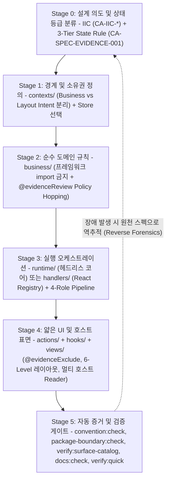

# 스펙 기반 코드 작성 가이드 (Spec-to-Code Authoring Guide)

**상태:** Active  
**스펙 / 결정 ID:** `CA-SURFACE-CATALOG-001`, `CA-SPEC-EVIDENCE-001`, `CA-STATECHART-EFFECT-001`, `CA-ELEMENT-INTEROP-001`  
**소유자:** Framework Core, React Runtime & Architecture Governance  
**관련 명세:**
- [개발 컨벤션 인덱스](./convention-index.md)
- [Implementation Playbook 표준 컨벤션](./implementation-convention.md)
- [Store별 선택 및 사용법 가이드](./store-selection-and-usage-guide.md)
- [Core Action Contracts](../../../packages/core/docs/action-contracts.md)
- [React State Contracts](../../../packages/react/docs/state-contracts.md)
- [상호작용 의도 계약에서 구현까지의 흐름](./interaction-intent-implementation-flow.md)
- [통합 트라이어드 자율 동기화 가이드](./triad-evidence-sync-guide.md)

Context-Action은 **스펙의 설계 의도, 도메인 상태, 실행 파이프라인, UI 바인딩, 자동 검증 게이트가 서로 1:1로 대응**되도록 설계된 프레임워크입니다. 새 기능을 구현할 때마다 여러 문서를 왕복하지 않고, 설계 스펙에서 실제 코드와 검증 명령까지 한 번에 관통할 수 있도록 작성 흐름 전체를 하나로 묶었습니다.

---

## 1. End-to-End 스펙-코드 파이프라인



---

## 2. 스펙 ↔ 레이어 ↔ 검증 게이트 매핑 매트릭스

| 작성 단계 | 대상 디렉터리 / 산출물 | 핵심 코드 작성 규칙 | 기준 명세 문서 | 강제 범위 & 검증 수단 |
| --- | --- | --- | --- | --- |
| **Stage 0 · 의도 & 상태 티어링** | 설계 스펙 / PR / `@evidence*` | UX 단축·대체 신호·복구 경로 기록(`CA-IIC-*`); **2-Second State Rule** 적용 (`Tier 1` TypeSpec + `@evidenceReview`, `Tier 2` 클라이언트 계산·활동 로그, `Tier 3` 휘발성 UI 상태 제외) | [IIC 구현 흐름](./interaction-intent-implementation-flow.md), [CA-SPEC-EVIDENCE-001](./decisions/CA-SPEC-EVIDENCE-001.md) | **권고 / 크로스-레포 (`Advisory / Cross-Repo`)** — 인접 `ttsc-ex` / `oa-sdk` Policy Hopping 게이트 실행 시 fail-closed |
| **Stage 1 · 경계 & Store 선택** | `contexts/` (`*Contexts.tsx`, `*Context.ts`) | **`BusinessActionIntent`** 와 **`LayoutActionIntent`** 분리(**No Mixed Payloads**); 도메인 규모별 점진적 도입(`Level 1 Lite`, `Level 2 Standard Headless-First DI`, `Level 3 Enterprise 6-Layer`); Store 매트릭스에 따른 프리미티브 선택 | [Store 선택 가이드](./store-selection-and-usage-guide.md), [트라이어드 가이드](./triad-evidence-sync-guide.md) | **레포 CI 강제 (`CI-Enforced`)**: `pnpm convention:check`, `pnpm package-boundary:check` |
| **Stage 2 · 순수 도메인 로직** | `business/` (`*Draft.ts`, `*Validation.ts`, `*Result.ts`, `*Activity.ts`, `*StateMachine.ts`) | **React 및 `@context-action/*` import 전면 금지**; 순수 전이 `state + event -> nextState`; UI 문구·DOM 호출 배제; UI 문자열 대신 도메인 이벤트 정의 | [표준 컨벤션](./implementation-convention.md), [명시적 상태 머신](./patterns/explicit-state-machine.md) | **레포 CI 강제 (`CI-Enforced`)**: `pnpm convention:check` (`business/` 파일명 및 import 경계 검사) |
| **Stage 3A · 헤드리스 엔진 (선택)** | `runtime/` (`create*.ts`, `*.test.ts`) | React 없이 Node/Worker/Preact/Lit에서도 동작하는 순수 TS 엔진 조립 (`ActionRegister` + `createStore` / `createStateStore` / `TimeTravelStoreManager`); **`react`/`react-dom` 및 React 하위 레이어 import 금지** | [Context-Layered 가이드](./context-layered-guide.md), [Headless-First 예제](/ko/examples/basic-setup) | **레포 CI 강제 (`CI-Enforced`)**: `pnpm convention:check` (`runtime/` `.ts` 파일명 및 React/UI import 금지) |
| **Stage 3B · React 오케스트레이션** | `handlers/` (`*HandlerRegistry.tsx`, `use*Handlers.tsx`, `*HandlerSupport.ts`) | 3단계 커밋 루프(`getValue()` → `business/` → `setValue()`/`update()`); **4-역할 핸들러 훅** 사용; 다중 스토어 원자적 Undo는 `StoreTransactionCoordinator` / `bindActionTransactions`; 분리 애스펙트 복원은 `Promise.allSettled` 병렬 처리 | [Core Action Contracts](../../../packages/core/docs/action-contracts.md), [React State Contracts](../../../packages/react/docs/state-contracts.md) | **레포 CI 강제 (`CI-Enforced`)**: `pnpm convention:check` (`handlers/` 외 직접 핸들러 훅 호출 금지 및 `Action → Store → Ref → Registry` 순서 검증) |
| **Stage 4 · 얇은 UI & 호스트 브리지** | `actions/`, `hooks/`, `views/` (`.tsx`) | `actions/`는 raw `dispatch`를 숨긴 의미적 명령만 노출; `hooks/`는 `StoreReader` 기반 화면 파생 모델 생성; `views/`는 파일 상단 `@evidenceExclude`, `runtime/`/`business/`/`handlers/` 런타임 import 금지, 6-Level 레이아웃·4-Tier Z-Index 준수; Preact/Lit은 읽기 전용 브리지 사용 | [폴더 구조](./architecture/folder-structure.md), [CA-ELEMENT-INTEROP-001](./decisions/CA-ELEMENT-INTEROP-001.md) | **레포 CI 강제 (`CI-Enforced`)**: `pnpm convention:check`, `pnpm --filter example check`, `pnpm verify:element-interop` |
| **Stage 5 · 카탈로그, 문서 & 영수증** | `catalog/repository-surface/*.json`, 한/영 `docs/{en,ko}/**`, `.verification/local-receipt.json` | 한/영 문서 쌍, `api/example/document-surface.v1.json`, `docs/{en,ko}/llms/llms-*.txt`(`pnpm docs:llms`) 및 `<!-- @context-action-compile -->` 스니펫 동기화; clean 커밋 후 로컬 영수증 갱신 | [문서 개발 컨벤션](../concept/documentation-development-conventions.md), [CA-SURFACE-CATALOG-001](./decisions/CA-SURFACE-CATALOG-001.md) | **레포 CI 강제 (`CI-Enforced`)**: `pnpm verify:surface-catalog`, `pnpm verify:doc-snippets`, `pnpm docs:check`, `pnpm verify:quick`, `pnpm verify:receipt` |

---

## 3. 권장 4-Role Action API 위계

Context-Action은 하나의 액션 파이프라인을 **승인(Admission) → 실행 및 결과(Execution & Result) → 정산 후 관찰(Settlement Observation)** 의 4가지 역할로 분리합니다. 구조화된 워크플로에서는 검증, 상태 변이, 결과 반환, 부가 관찰이 뒤섞이지 않도록 전용 역할 API를 우선 사용하세요:

| 위계 | Core `ActionRegister` API | React `ActionContext` 훅 | 권장 책임 |
| --- | --- | --- | --- |
| **정식 · Guard (승인/차단)** | `registerGuard(action, fn, config)` | `useActionGuard` | 상태 변이 전 입력·권한을 검사하고 무효 시 `controller.abort()`로 중단 |
| **정식 · Command (실행/커밋)** | `registerCommand(action, fn, config)` | `useActionCommandHandler` | 도메인 로직 실행 및 Store 커밋 (`getValue()` → `business/` → `setValue()`/`update()`) |
| **정식 · Result (결과 산출)** | `registerResult(action, fn, config)` | `useActionResultHandler` | `dispatchWithResult()`가 수집하는 타입 안전 반환값 계산 |
| **정식 · Observer (정산 후 관찰)** | `registerObserver(action, fn, config)` | `useActionObserver` | 정산 결과(`event.result`, `event.outcome`) 기반 로그·텔레메트리·UI 동기화 (abort/결과 권한 없음) |
| **Lite / 호환용** | `register(action, fn, config)` | `useActionHandler` | Level 1 Lite 기능이나 레거시 마이그레이션 시 허용되는 범용 훅 |
| **비권장 이행용 (Deprecated)** | `registerEffect(action, fn, config)` | `useActionEffectHandler` | **Deprecated.** `effectKind: 'guard'`는 `useActionGuard`로, `'observer'`는 `useActionObserver`로 이행 |

---

## 4. End-to-End 코드 작성 예시 (Spec → Headless Runtime → React DI)

아래 예제는 실제로 `pnpm verify:doc-snippets`의 엄격한 TypeScript 컴파일 검증을 통과하는 **Headless-First Symmetric DI** 패턴입니다. 인텐트 분리(`BusinessActionIntent` vs `LayoutActionIntent`), 순수 `business/` 규칙, 프레임워크 비의존 `createStateStore` + `ActionRegister` 4-역할 파이프라인, 그리고 `ownership="shared"` React Context 주입까지 전 과정을 담고 있습니다:

<!-- @context-action-compile -->
```tsx
import { ActionRegister, type ActionPayloadMap } from '@context-action/core';
import { createStateStore, type StateMutationMeta } from '@context-action/store-core';
import {
  createActionContext,
  createStore,
  createStoreContext,
  useStoreValue,
} from '@context-action/react';
import { createBackendStore } from '@context-action/react/backend';

// Stage 1: BusinessActionIntent와 LayoutActionIntent 물리 분리 (No Mixed Payloads)
interface OrderBusinessActions extends ActionPayloadMap {
  submitOrder: { sku: string; qty: number };
}

interface OrderResultMap {
  submitOrder: { accepted: boolean; total: number };
}

interface OrderLayoutActions extends ActionPayloadMap {
  toggleSummaryDrawer: { open?: boolean };
}

interface OrderState {
  readonly lastSku: string | null;
  readonly total: number;
  readonly error: string | null;
}

// Stage 2: 순수 business/ 규칙 (프레임워크 import 없음)
function validateOrderInput(sku: string, qty: number): string | null {
  if (!sku.trim()) return 'SKU is required.';
  if (qty <= 0) return 'Quantity must be positive.';
  return null;
}

function computeOrderTotal(qty: number): number {
  return qty * 25;
}

// Stage 3A: 순수 TypeScript 헤드리스 runtime/ 조립 (Node, Worker, Preact, Lit, React 공용)
export function createHeadlessOrderRuntime() {
  const initialOrder: OrderState = { lastSku: null, total: 0, error: null };
  const orderStore = createStore<OrderState>('order', initialOrder);
  const telemetryBackend = createStateStore('telemetry', { completedCount: 0 });
  const telemetryReactStore = createBackendStore('telemetry', telemetryBackend, {
    ownership: 'shared',
  });

  const register = new ActionRegister<OrderBusinessActions, OrderResultMap>({
    name: 'OrderEngine',
  });

  // Guard (승인 단계): 상태 커밋 전에 유효성 검증 및 중단
  register.registerGuard(
    'submitOrder',
    ({ sku, qty }, controller) => {
      const error = validateOrderInput(sku, qty);
      if (error) {
        orderStore.update((prev) => ({ ...prev, error }));
        controller.abort(error);
      }
    },
    { id: 'order-input-guard', priority: 100 },
  );

  // Command / Result: 순수 계산 후 상태 커밋 및 결과 반환
  register.registerResult(
    'submitOrder',
    ({ sku, qty }) => {
      const total = computeOrderTotal(qty);
      orderStore.setValue({ lastSku: sku.trim(), total, error: null });
      return { accepted: true, total };
    },
    { id: 'order-submit-command', priority: 10 },
  );

  // Observer: 파이프라인 정산 후 후속 관찰 (abort/결과 권한 없음)
  register.registerObserver(
    'submitOrder',
    (event) => {
      if (event.outcome === 'completed') {
        const meta: StateMutationMeta = { origin: 'system', label: 'order-settled' };
        telemetryBackend.update((prev) => ({ completedCount: prev.completedCount + 1 }), meta);
      }
    },
    { id: 'order-audit-observer', priority: 1 },
  );

  const LayoutActions = createActionContext<OrderLayoutActions>('OrderLayout');
  const BusinessActions = createActionContext<OrderBusinessActions, OrderResultMap>('OrderBusiness');
  const OrderStores = createStoreContext('OrderStores', {
    order: { initialValue: initialOrder },
    // Tier 3 휘발성 UI 상태는 TypeSpec/Evidence 면제 대상
    drawerOpen: false,
  });

  return {
    orderStore,
    telemetryReactStore,
    register,
    BusinessActions,
    LayoutActions,
    OrderStores,
  };
}

const runtime = createHeadlessOrderRuntime();

// Stage 4: Symmetric DI (ownership="shared")로 연결된 얇은 React View
function OrderPanel() {
  const dispatch = runtime.BusinessActions.useActionDispatch();
  const orderStore = runtime.OrderStores.useStore('order');
  const order = useStoreValue(orderStore);
  const telemetry = useStoreValue(runtime.telemetryReactStore);

  return (
    <button
      type="button"
      onClick={() => void dispatch('submitOrder', { sku: 'CA-BOOK', qty: 2 })}
    >
      총 주문 금액: {order.total} (완료: {telemetry.completedCount})
    </button>
  );
}

export function OrderFeature() {
  return (
    <runtime.BusinessActions.Provider register={runtime.register} ownership="shared">
      <runtime.OrderStores.Provider
        stores={{ order: runtime.orderStore }}
        ownership="shared"
      >
        <OrderPanel />
      </runtime.OrderStores.Provider>
    </runtime.BusinessActions.Provider>
  );
}
```

> **점진적 도입 기준:** 단순한 로컬 위젯은 **Level 1 Lite**(`createActionContext` + `createStoreContext` + `useActionHandler`)로 시작하고, React 밖에서 검증·상태 전이를 단독 테스트하거나 멀티 호스트로 공유해야 하는 시점에 `business/`와 헤드리스 `runtime/`으로 분리하세요.

---

## 5. 멀티 호스트 Store Reader 브리지 (`React` · `Preact` · `Lit`)

헤드리스 코어 스토어(`@context-action/store-core` `createStateStore`)나 `@context-action/react` `Store` 1개를 여러 UI 런타임에서 함께 소비할 때는 각 어댑터가 기대하는 `getSnapshot()` 반환 형태를 확인하세요:

| 호스트 어댑터 | Reader 계약 | `getSnapshot()` 반환 형태 | 명시적 브리지 필요 여부 |
| --- | --- | --- | --- |
| **React** (`@context-action/react`, `@context-action/react/backend`) | `StoreReader<T>` / `StateReader<T>` | `Snapshot<T>` (`{ value, name, lastUpdate, version? }`) | `Store`/`TimeTravelStore`는 불필요; 커스텀 `StateBackend`는 `createBackendStore()` 사용 |
| **Preact Signals** (`@context-action/preact`) | `ReadableSource<T>` | **원시 값 `T` 직접 반환** | **`fromStateReader(reader)`** 로 `{ value: T }` 래퍼를 명시적으로 언래핑 |
| **Lit** (`@context-action/lit`) | `ReadableStore<T>` | `getValue(): T` (+ `subscribe`) | `Store`, `TimeTravelStore`, `createStateStore()` 모두 그대로 전달 가능 |

도메인 상태 `T` 자체에 `.value` 필드가 존재할 수 있으므로, `@context-action/preact`는 `connectSourceSignal()` 내부에서 `'value' in snapshot` 같은 암묵적 덕 타이핑을 하지 않고 **`fromStateReader()` 어댑터로 변환 의도를 명시**하도록 설계되어 있습니다:

```ts
import { createStateStore } from '@context-action/store-core';
import { connectSourceSignal, fromStateReader } from '@context-action/preact';
import { StoreController } from '@context-action/lit';

// UI 런타임 바깥에 존재하는 프레임워크 중립 스토어 1개
export const sharedSessionStore = createStateStore('session', { step: 1 });

// 1. Preact Signals 읽기 전용 투영 (fromStateReader로 스냅샷 래퍼 언래핑)
export const preactSession = connectSourceSignal(fromStateReader(sharedSessionStore));

// 2. Lit ReactiveController 투영 (getValue + subscribe를 구현하므로 직접 연결)
// LitElement 호스트 내부:
// private session = new StoreController(this, sharedSessionStore);
```

---

## 6. 대표 라이브 예제 및 PR 전 검증 체크리스트

저장소 내 다음 라이브 경로에서 각 아키텍처 패턴의 실제 구현을 확인할 수 있습니다:

- **Enterprise 6-Layer Playbook (React HandlerRegistry + 순수 business + 명시적 FSM + IIC):**
  - `/patterns/implementation-playbook` (`example/src/pages/patterns/implementation-playbook/`)
  - `/patterns/implementation-playbook/access-request`
  - `/patterns/implementation-playbook/incident-escalation`
  - `/patterns/implementation-playbook/renewal-risk-review`
- **Headless-First Symmetric DI (`runtime/` + `ownership="shared"` React DI):**
  - `/foundations/react/headless-di` (`example/src/pages/foundations/react/headless-di/`)
- **도구 호출형 AI 워크스페이스 (`tool-protocol` + `ai-sdk` + `webmcp` + `tool-durable-operations`):**
  - 독립 데모 `/web-coding/` (`demos/bolt-style-editor/`)

PR을 올리기 전에는 루트에서 다음 게이트들을 실행해 스펙·문서·코드 경계가 모두 맞물리는지 확인하세요:

```bash
pnpm convention:check
pnpm package-boundary:check
pnpm verify:surface-catalog
pnpm verify:doc-snippets
pnpm docs:check
pnpm verify:quick
pnpm verify:receipt
```
