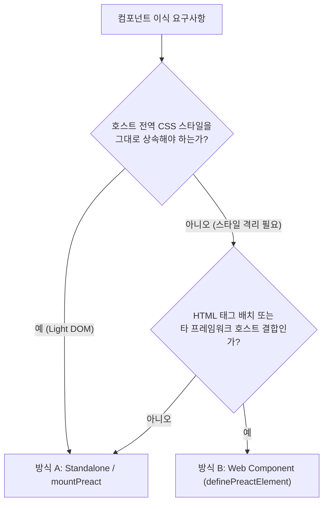

# 05. 임베드 아키텍처, FACE 폼 연동 및 React 호스트 브릿지 (Embed & Host Interop)

이 문서는 `@context-action/preact-ui`로 작성한 컴포넌트를 **순수 HTML(Standalone UMD / Web Component)**, **웹 표준 `<form>`(FACE)**, 그리고 **React 18/19 호스트 애플리케이션(`createCustomElementBridge` & OOP Facade)** 에 통합하는 표준 아키텍처를 정의합니다.

---

## 5.1 배포 방식 비교: Standalone UMD 마운트 vs Web Component

| 비교 축 | 방식 A: UMD / Light-DOM 마운트 (`mountPreact`) | 방식 B: Web Component (`definePreactElement`) |
|---|---|---|
| **소비 형태** | 명령형 JS API (`mountOrderWorkspace(root, model)`) | 선언적 HTML 태그 (`<order-workspace>`) |
| **DOM 및 스타일 경계** | Host Light DOM (호스트 전역 CSS·테마 자연 상속) | Shadow DOM (`mode: 'open'`, 외부 CSS 격리 및 `::part` 허용) |
| **수명 관리** | 호스트가 `mount.destroy()` 명시적 호출 | `connectedCallback` / `disconnectedCallback` 자동 연동 |
| **재연결 탄력성** | 호스트 스크립트가 수동으로 재마운트 | DOM detach/reattach 시 인스턴스 도메인 상태 자동 보존 |
| **외부 통신** | 컨트롤러 핸들 메서드 및 모델 `source.subscribe()` | 표준 Property, Attribute, CustomEvent 및 OOP Facade |
| **최적 활용처** | CMS, 서버 템플릿(JSP/Rails), 동일 모델 공유 멀티 아일랜드 | 다중 프레임워크(React/Vue/Angular) MFE, 서드파티 SDK 위젯 |



### 자체 포함(Self-Contained) Standalone 번들 구성
`pnpm --filter @context-action/preact-ui build:standalone`은 외부 호스트에 별도 프레임워크 설치를 요구하지 않도록 Preact, `@preact/signals`, `@context-action/core`, `@context-action/preact`, `@context-action/preact-ui` 및 참조 Custom Elements를 `dist-standalone/order-workspace.{umd,iife,es}.js`로 패키징합니다. (코호트별 번들 크기 측정치는 [`history/validation-history.md`](history/validation-history.md) 참조)

---

## 5.2 Form-Associated Custom Elements (FACE) 표준 폼 연동

`definePreactElement`에 `formAssociated: true`를 설정하면 `ElementInternals`를 통해 브라우저 네이티브 `<form>`, `new FormData(form)`, `checkValidity()`, `reportValidity()`, `form.reset()`과 직접 통합됩니다.

### 1) 작성자 전용 `PreactElementContext` 계약
`setup(element, context)`의 `context`는 작성자 전용 어댑터 입력으로 contextual typing됩니다(소비자 API로 재-export하지 않음):

```ts
interface PreactElementContext {
  readonly internals?: ElementInternals | undefined;
  /** 렌더러가 소유한 내부 mount root (focus/selection 위임 시에만 제한적으로 사용) */
  readonly root: HTMLElement;
  /** 현재 활성 connection session의 전체 input snapshot 갱신 요청 */
  readonly requestUpdate: () => void;
  /** 폼 제출 값 설정 */
  setFormValue(value: File | string | FormData | null, state?: File | string | FormData | null): void;
  /** 제약 검증 유효성 플래그 및 오류 메시지 설정 */
  setValidity(flags: ValidityStateFlags, message?: string, anchor?: HTMLElement): void;
}
```

### 2) FACE 구현 및 접근성 규칙 (`examples/modular-signals-wc/quantity-stepper-element.tsx`)
- **생성자 시점 제약**: 브라우저가 생성자 실행 중의 어트리뷰트·폼 상태 변이를 거부할 수 있으므로, 호스트 ARIA 속성(`role="spinbutton"`, `aria-valuenow` 등)과 초기 `setFormValue`/`setValidity` 동기화는 반드시 `onConnect()` 이후에 수행합니다.
- **폼 콜백 연동**: `onFormReset()`에서 Signal 값을 초기값으로 되돌리고, `onFormDisabled(disabled)`에서 비활성 상태를 반영합니다.
- **교차 Shadow DOM 접근성**: 호스트 `<label for="...">`와 `aria-labelledby`를 연결하고, 범위 초과 시 `setValidity({ rangeUnderflow: true }, message)`와 함께 호스트 `aria-invalid="true"`, `aria-description` 및 내부 `role="alert"` 라이브 리전을 동기화합니다.

---

## 5.3 React 18 / 19 상호운용성 브릿지 (`@context-action/preact-ui/react-bridge`)

React에서 Custom Element를 직접 렌더링할 때 발생하는 커스텀 이벤트 위임 누락, 복합 객체 프로퍼티의 `[object Object]` 문자열 직렬화, 그리고 원시 `HTMLElement` 노출로 인한 캡슐화 파괴를 해결합니다.

### 1) 프로퍼티 반영 타이밍 규칙
`properties`에 지정한 키는 React 커밋 이후 isomorphic layout effect에서 DOM 프로퍼티로 동기화됩니다. 따라서 Custom Element의 초기 연결(`connectedCallback`)은 기본 입력만으로도 안전하고 멱등적이어야 합니다.

### 2) `useImperativeHandle` 기반 OOP Facade 캡슐화 (`createHandle` & `createElementFacade`)
원시 `HTMLElement`를 부모 `ref`에 그대로 노출하면 외부에서 `ref.current.innerHTML = ''`, `ref.current.remove()`, `ref.current.shadowRoot` 등 내부 구조를 파괴할 수 있습니다. `createCustomElementBridge`의 `createHandle` 옵션에 `createElementFacade`를 결합하면 동결된(frozen) 도메인 OOP 핸들만 노출됩니다:

```tsx
import type { PublicActionMethods } from '@context-action/preact-ui';
import {
  createCustomElementBridge,
  createElementFacade,
} from '@context-action/preact-ui/react-bridge';
import type { OrderActions, OrderItem } from './business/order-types.js';
import type { OrderWorkspaceElement } from './order-contract.js';

export type OrderWorkspaceHandle = {
  customerName: string;
  shippingAddress: string;
  readonly items: readonly OrderItem[];
  submit(): Promise<void>;
  reset(): Promise<void>;
} & PublicActionMethods<OrderActions, 'addItem' | 'removeItem'>;

export interface OrderWorkspaceBridgeProps {
  customerName?: string;
  shippingAddress?: string;
  onOrderChange?: (event: CustomEvent) => void;
  onOrderSubmitSuccess?: (event: CustomEvent<{ orderId: string }>) => void;
}

export const ReactOrderWorkspace = createCustomElementBridge<
  OrderWorkspaceBridgeProps,
  OrderWorkspaceElement,
  OrderWorkspaceHandle
>({
  tagName: 'order-workspace',
  events: {
    onOrderChange: 'order-change',
    onOrderSubmitSuccess: 'order-submit-success',
  },
  createHandle: createElementFacade<
    OrderWorkspaceElement,
    readonly (keyof OrderWorkspaceHandle)[]
  >([
    'customerName',
    'shippingAddress',
    'items',
    'addItem',
    'removeItem',
    'submit',
    'reset',
  ]),
});
```

---

## 5.4 `@context-action/react` 함수형 파이프라인(`createRefContext` + `withTarget`) 결합

React 호스트가 `@context-action/react`를 사용하는 경우, `createRefContext`에 원시 DOM 노드 대신 `OrderWorkspaceHandle`을 등록하여 액션 핸들러 내부에서 객체지향 메시지 패싱(`withTarget`)으로 위젯을 오케스트레이션합니다:

```tsx
import React, { useCallback } from 'react';
import { createActionContext, createRefContext } from '@context-action/react';
import { ReactOrderWorkspace, type OrderWorkspaceHandle } from './order-bridge.js';

interface HostCheckoutActions {
  quickAddBundle: { customerName: string };
  clearWorkspace: void;
}

const {
  Provider: CheckoutActionProvider,
  useActionDispatch: useCheckoutAction,
  useActionHandler: useCheckoutActionHandler,
} = createActionContext<HostCheckoutActions>('HostCheckoutActions');

const {
  Provider: CheckoutRefProvider,
  useRefHandler: useCheckoutRef,
} = createRefContext<{ orderPad: OrderWorkspaceHandle }>('HostCheckoutRefs');

function CheckoutLogic({ children }: { children: React.ReactNode }) {
  const orderPad = useCheckoutRef('orderPad');

  useCheckoutActionHandler(
    'quickAddBundle',
    useCallback(
      async ({ customerName }) => {
        await orderPad.withTarget(async (handle) => {
          handle.customerName = customerName;
          await handle.addItem({
            id: 'bundle-starter',
            name: '스타터 패키지',
            unitPrice: 29000,
            quantity: 1,
          });
          await handle.submit();
        });
      },
      [orderPad],
    ),
  );

  useCheckoutActionHandler(
    'clearWorkspace',
    useCallback(async () => {
      await orderPad.withTarget((handle) => handle.reset());
    }, [orderPad]),
  );

  return <>{children}</>;
}

function CheckoutView() {
  const dispatch = useCheckoutAction();
  const orderPad = useCheckoutRef('orderPad');

  return (
    <section>
      <button type="button" onClick={() => dispatch('quickAddBundle', { customerName: '홍길동' })}>
        원클릭 번들 주문
      </button>
      <ReactOrderWorkspace ref={orderPad.setRef} />
    </section>
  );
}
```
