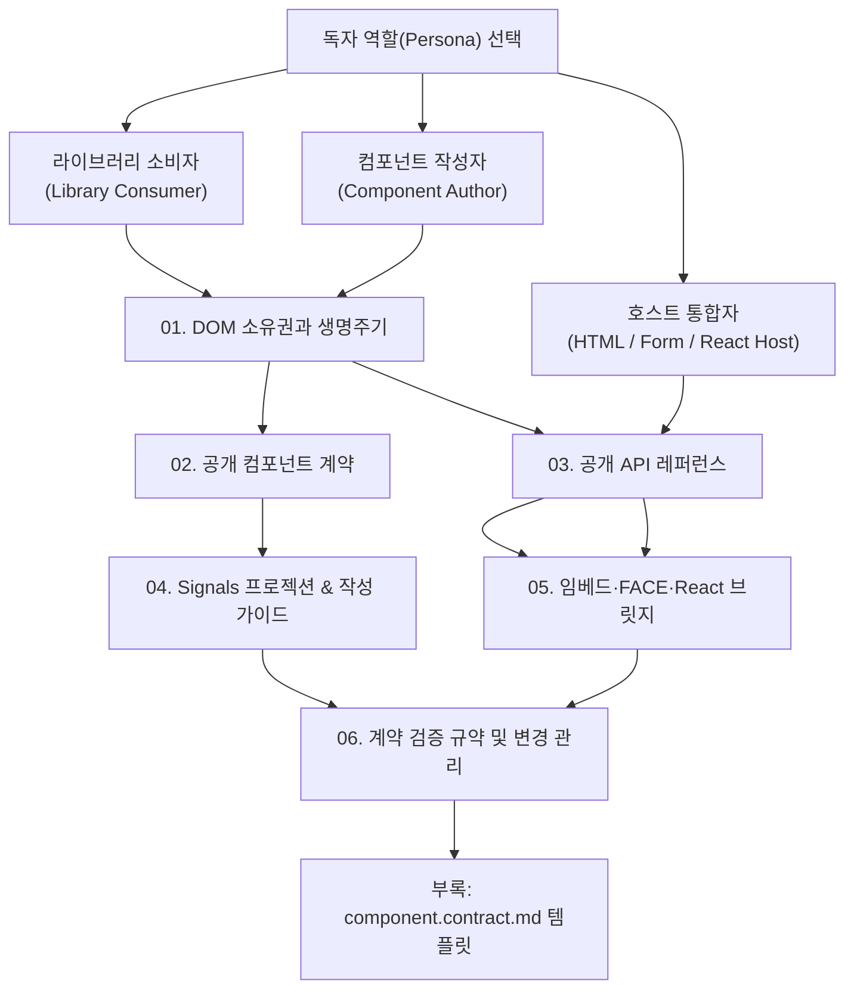

# `@context-action/preact-ui` & `@context-action/preact` 공식 문서 인덱스

이 디렉터리는 `@context-action/preact` 헤드리스 어댑터와 `@context-action/preact-ui` 서브트리 UI 런타임의 **정본(Single Source of Truth, SSOT)** 문서 세트입니다.

중복 없이 정예화된 **6개의 핵심 규약 문서(`01` ~ `06`)** 와 **표준 부록(`templates/`, `references.md`)**, 그리고 **릴리즈 검증 이력 아카이브(`history/`)** 로 구성되어 있습니다.

---

## 1. 독자 역할별 권장 학습 경로 (Reading Path by Persona)

- **라이브러리 소비자 (Library Consumer)**: 기존 웹 앱, CMS, 템플릿에 Preact 아일랜드나 Web Component를 마운트하고 제어하려는 경우 `01` → `03` → `05` 순서로 읽습니다.
- **컴포넌트 작성자 (Component Author)**: Context-Layered 6계층 구조와 `definePreactElement<Input, Expose>`를 사용해 새로운 도메인 위젯이나 Custom Element를 설계·구현하려는 경우 `01` → `02` → `04` → `06` 및 [`templates/component.contract.md`](templates/component.contract.md) 순서로 읽습니다.
- **호스트 통합자 (HTML / Form / React Integrator)**: 표준 `<form>`(FACE) 또는 React 18/19 애플리케이션 내에서 Custom Element를 캡슐화된 OOP 핸들(`createCustomElementBridge`, `createElementFacade`) 및 `@context-action/react`의 `createRefContext`와 결합하려는 경우 `03` → `05` → `06` 순서로 읽습니다.

---

## 2. 정예 6대 정본 문서 (Core Canonical Specifications)

| 문서 | 핵심 주제 및 정본 범위 |
|---|---|
| [`01-dom-ownership-and-lifecycle.md`](01-dom-ownership-and-lifecycle.md) | **DOM 소유권 경계와 생명주기 규약** — Host와 Renderer(`root.children`)의 책임 분리, Light-DOM 충돌 차단, Shadow DOM 격리, Element 인스턴스 수명 vs Connection Session 수명, LIFO 정리(`createDisposalScope`), 비동기 취소 및 실패 복구 |
| [`02-public-component-contract.md`](02-public-component-contract.md) | **공개 컴포넌트 계약** — 입력(Attribute/Property/Method)·검증·반영 규칙, 외부 제어형(`selection-request`) vs 내부 상태형(`value-change`) 권한 분리, 의미 중심 명령, CustomEvent 규약, 스타일·슬롯·접근성 |
| [`03-api.md`](03-api.md) | **공개 API 레퍼런스** — `@context-action/preact`(`createDispatchContext`, `connectSourceSignal`, `createSourceContext`, `useProjection`), `@context-action/preact-ui`(`mountPreact`, `hydratePreact`, `mountTemplate`, `createDisposalScope`, `definePreactElement<Input, Expose>`, `ExposeContract`, `ReservedElementKey`, `PublicActionMethods`, `createElementFacade`), `./react-bridge`(`createCustomElementBridge`), `./ssr`(`createSSR`) |
| [`04-signals-and-component-authoring.md`](04-signals-and-component-authoring.md) | **Signals 프로젝션 및 컴포넌트 작성 가이드** — Context-Layered 6계층 구조, `use<Domain>Projection`(`ReadonlySignal`)과 `use<Domain>Actions` 분리, Tier 3 로컬 상태 면제, 3계층 모듈식 Web Component, 선언적 `expose` 및 `PublicActionMethods` 작성법, Shell 콜백·등록 규칙과 완료 기준 |
| [`05-embed-and-host-interop.md`](05-embed-and-host-interop.md) | **임베드 아키텍처, FACE 폼 연동 및 React 호스트 브릿지** — Standalone UMD vs Web Component 비교, `ElementInternals` 기반 FACE 폼 참여 및 접근성, `useImperativeHandle` OOP Facade(`createHandle`/`createElementFacade`), `@context-action/react` `createRefContext` + `withTarget` 결합 |
| [`06-validation-and-governance.md`](06-validation-and-governance.md) | **계약 검증 규약 및 변경 관리** — 정본 스펙과 이력 분리 원칙, 7대 검증 게이트, 6대 런타임 불변 조건, 9대 컴포넌트 계약 검증 범주, 소비자 QA 경계 및 변경 영향 관리 |

---

## 3. 표준 부록 및 이력 아카이브 (Appendices & History Archive)

| 자료 | 역할 및 설명 |
|---|---|
| [`templates/component.contract.md`](templates/component.contract.md) | **컴포넌트 계약 작성 템플릿** — 신규 컴포넌트 설계 시 목적, 소유권, 입력, 명령/이벤트, 수명, 접근성, 검증 참조를 기록하는 표준 양식 |
| [`references.md`](references.md) | **플랫폼 표준 레퍼런스 (`R0` ~ `R10`)** — WHATWG HTML/DOM, CSS Shadow Parts, W3C WAI-ARIA, Preact Signals 공식 명세 대조표 |
| [`history/validation-history.md`](history/validation-history.md) | **릴리즈 코호트 검증 및 변경 이력 아카이브** — `0.2.0` (`2026-10-18`), `0.1.0` (`2026-10-02`) 릴리즈 코호트별 검증 결과표, 변이(Mutation) 검증 요약 및 standalone 번들 크기 측정 기록 |
