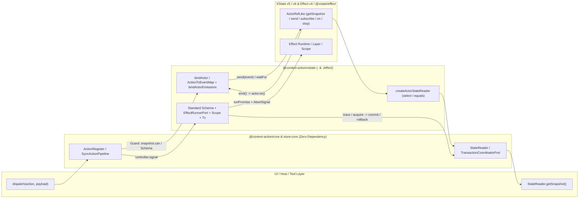

# Role-Allocated Architecture: `@context-action/xstate` & `@context-action/xstate/effect`

**Decision Record:** [`CA-STATECHART-EFFECT-001`](../../../docs/en/context-layered/decisions/CA-STATECHART-EFFECT-001.md) (KO: [한국어 결정 기록](../../../docs/ko/context-layered/decisions/CA-STATECHART-EFFECT-001.md))

This specification defines the role-allocated abstraction separating core zero-dependency contracts (`@context-action/core`, `@context-action/store-core`) from optional XState v5 / v6 and Effect v4 / `@xstate/effect` adapters inside `@context-action/xstate` (`.` and `./effect`).

## 1. Five Core Philosophical Invariants

1. **Zero-Dependency Core Purity**:
   - `@context-action/core` and `@context-action/store-core` declare zero external dependencies and never import XState, Effect, Standard Schema, or `@context-action/xstate`.
2. **Single Intent Entry & Single Projection Exit**:
   - Hosts express intents strictly via `ActionRegister` or `SyncActionPipeline`, and observe state strictly via monotonic versioned `StateReader<TSelected>` snapshots (`createActorStateReader` with `select` + `equals` and stale-free reads prior to `subscribe()`).
3. **Open Store vs Closed Statechart Authority**:
   - A `StateStore<T>` permits open external mutations via `setValue()` / `update()`. In contrast, an `ActorRefLike` is a **closed transition store**: state transitions occur strictly via guarded pipeline events (`snapshot.can(event)` in Guard → `actor.send(event)` in Handler), while outbound machine emissions flow back strictly via `createActorActionEmitter` or `bindActorEmissions` (`actor.on`).
4. **Cooperative Lifecycle & Scoped Interruption**:
   - Cancellation propagates end-to-end (`controller.signal` → `waitForActorSnapshot`, `registerEffectHandler`, `registerEffectGuard`, `runInTransactionScope`), `bindActionDispatchTransactions` / `runInTransactionScope` enforce single-shot atomic `commit()` / `rollback()` over explicit store participants, and every binding returns a callable `BoundActorHandle` / `BoundEffectActorHandle` (`handle()`, `handle.unbind()`, `handle.dispose()`, `handle.canDispatch()`, `handle.getSnapshot()`, `handle.isDisposed()`).
5. **Three-Tier State Alignment (`CA-SPEC-EVIDENCE-001`)**:
   - Tier 1 durable domain transitions & schemas live in `ActionSchemaLike` / `fromStandardSchema` + XState actors on `ActionRegister`; Tier 2 derived UI views consume `createActorStateReader({ select, equals })`; Tier 3 volatile 0ms DOM interaction runs on `@context-action/core/element` `SyncActionPipeline` (`bindActorToSyncPipeline`).

## 2. Core Conceptual Model



## 3. Standardized Package & Role Matrix

| Layer | Package | Owns | Does Not Own |
| :--- | :--- | :--- | :--- |
| **Zero-Dependency Core** | `@context-action/core` (`./element`) | `ActionRegister`, `ActionSchemaLike`, `SyncActionPipeline`, `createElementBinding`, WAI-ARIA helpers | XState actors, Effect Fibers, Standard Schema adapters |
| **Zero-Dependency Store** | `@context-action/store-core` | `StateReader`, `ReadonlyStateSnapshot`, `StateStore`, `TransactionCoordinatorPort` | Actor polling/projection or Effect scope runtime |
| **Track 1: XState Adapter** | `@context-action/xstate` | `bindActor`, `bindActorToActionRegister`, `bindActorToSyncPipeline`, `bindActorEmissions`, `waitForActorSnapshot`, `createActorStateReader`, `createActorActionEmitter`, `enqueueSyncCommand`, `BoundActorHandle` | Direct DOM manipulation |
| **Track 2: Effect Adapter** | `@context-action/xstate/effect` | `fromStandardSchema`, `registerStandardSchemaGuard`, `registerEffectGuard`, `registerEffectHandler`, `bindEffectActorToActionRegister`, `runInTransactionScope`, `bindActionDispatchTransactions` | Duplicating `@xstate/effect` (`setupEffect`, `fromEffect`) internals |

## 4. Standardized Interfaces Summary

1. **Universal Mounting & `BoundActorHandle` (`bindActor`)**:
   - Mounts onto either `ActionRegister` or `SyncActionPipeline` and returns a callable function handle (`handle()` === `handle.unbind()`) equipped with `.canDispatch(action, payload?)`, `.getSnapshot()`, `.isDisposed()`, `.unbind()`, and `.dispose()`.
2. **Bidirectional Emissions (`bindActorEmissions` & `options.emissions`)**:
   - Subscribes to XState v5/v6 `actor.on(eventType, ...)` emissions directly inside `bindActor(...)` or standalone via `bindActorEmissions(actor, target, emissions)`, tearing them down automatically on `unbind()` / `dispose()`.
3. **Standard `ActorRefLike` + `waitForActorSnapshot`**:
   - Accepts native XState v5/v6 `createActor()` and `@xstate/effect` `createEffectActor()` (`{ getSnapshot, send, subscribe, stop?, on? }`) without custom RPC shims.
4. **Stale-Free `createActorStateReader`**:
   - Synchronizes snapshots on `getSnapshot()`/`getValue()` even prior to the first `subscribe()` call and supports `select` + `equals`.
5. **Framework-Neutral Trace & Scope Transactions (`bindActionDispatchTransactions` & `runInTransactionScope`)**:
   - Connects `ActionRegister.subscribeDispatchTrace` directly to `@context-action/store-core`'s `TransactionCoordinatorPort` in headless / Vanilla DOM / Node hosts, mirroring `@context-action/react`'s `bindActionTransactions()` without a React dependency.

## 5. Usage Recipes

### Standardized Bidirectional XState v5/v6 Integration (`@context-action/xstate`)

```ts
import { ActionRegister } from '@context-action/core';
import {
  bindActor,
  createActorStateReader,
} from '@context-action/xstate';

type PlayerActions = {
  play: { trackId: string };
  pause: void;
  trackChanged: { trackId: string };
};

const register = new ActionRegister<PlayerActions>();

const handle = bindActor(register, playerActor, {
  map: {
    play: ({ trackId }) => ({ type: 'PLAY', trackId }),
    pause: 'PAUSE',
  },
  waitForByAction: {
    play: (snapshot) => snapshot.matches?.('playing') ?? snapshot.value === 'playing',
  },
  emissions: {
    TRACK_CHANGED: 'trackChanged',
  },
});

if (handle.canDispatch('play', { trackId: 't-1' })) {
  await register.dispatchWithResult('play', { trackId: 't-1' });
}

const reader = createActorStateReader('player-status', playerActor, {
  select: (snap) => ({ state: snap.value, trackId: snap.context.trackId }),
  equals: (a, b) => a.state === b.state && a.trackId === b.trackId,
});

// Cleanup (callable or method):
handle.dispose();
reader.dispose();
```

### `@context-action/xstate/effect` (Schema, Fiber Interruption, Scope & Transactions)

```ts
import {
  bindActionDispatchTransactions,
  bindEffectActorToActionRegister,
  fromStandardSchema,
  registerEffectHandler,
  registerStandardSchemaGuard,
  runInTransactionScope,
} from '@context-action/xstate/effect';

const register = new ActionRegister({
  registry: { schema: { createOrder: fromStandardSchema(orderStandardSchema) } },
});

const unbindTx = bindActionDispatchTransactions(register, coordinator, {
  getParticipants: () => participants,
});

registerStandardSchemaGuard(register, 'submitOrder', submitOrderStandardSchema);

registerEffectHandler(
  register,
  'submitOrder',
  (payload) => Effect.gen(function* () { /* ... */ }),
  { runner: (eff, opts) => managedRuntime.runPromise(eff, opts) },
);

const actorHandle = bindEffectActorToActionRegister(register, effectActor, {
  map: { checkout: 'CHECKOUT' },
  scope: closeableEffectScope,
});

await runInTransactionScope(coordinator, participants, async () => {
  await register.dispatch('submitOrder', orderInput);
});

await actorHandle.dispose(); // unbinds pipeline + emissions, closes Effect Scope, stops active actor
unbindTx();
```
